# Data Model: Personal Brand Voice

Feature: `001-personal-brand-voice`. Store: PostgreSQL 17 through Drizzle (`@voicespark/db`). Content bodies live in Supermemory (namespace `vs_user_{userId}`, document id `{contentItemId}`); Postgres holds metadata only, plus encrypted generated artifacts.

## Conventions

- snake_case tables and columns. Enums are Postgres enums or text with a check constraint; the literals are identical in TypeScript.
- `id uuid pk` (UUID v4, including Better Auth ids via `advanced.database.generateId`). `created_at` and `updated_at` are `timestamptz` everywhere (omitted from the field lists below only where a table has an explicit alternative such as `occurred_at`).
- Columns suffixed `_enc` are AES-GCM ciphertext (`text`) and are content-class: admin repositories never select them (see "Content-class columns").
- `ON DELETE CASCADE` from `user` to every user-owned table, except `audit_log_entry` and `deletion_request`, which use `SET NULL` so the record outlives the account.
- Enum literals are the canonical glossary names (`user_role`, `source_status`, `filter_category`, and so on) and are not redefined here beyond the inline value lists.
- "FR" references point at `spec.md`.

## Entities

### 1. user (Better Auth core table plus additional fields)

| Field | Type | Constraints |
|---|---|---|
| id | uuid | pk |
| name | text | not null |
| email | text | not null; primary contact |
| email_verified | bool | not null |
| image | text | nullable |
| role | user_role (`user`, `admin`) | default `user` |
| status | user_status (`active`, `suspended`, `pending_deletion`) | default `active` |
| suspended_at | timestamptz | nullable |
| suspended_by | uuid | nullable; admin user id |
| last_sign_in_at | timestamptz | nullable |
| created_at, updated_at | timestamptz | not null |

Rules:
- No password column (FR-002).
- A suspended user cannot create sessions (FR-006).
- At least one active admin must remain (FR-044). The check runs in a transaction with `SELECT ... FOR UPDATE` on the admin rows, before suspend or role revoke.

State machine (`status`): `active` -> `suspended` -> `active` (reinstate); `active|suspended` -> `pending_deletion` (account deletion requested, FR-047); the row is removed when the deletion completes.

### 2. session, account, verification (Better Auth standard tables)

- `account.provider_id` is one of `sign_in_provider` (`google`, `apple`, `microsoft`, `facebook`).
- `account` is the sign-in identity link only. Its OAuth tokens are unused (FR-005); mailbox access is stored in `mailbox_credential`.
- Sessions are never created for a user with `status = 'suspended'` (FR-006).

### 3. sign_in_identity (companion to `account`; Key Entity "Sign-in Identity")

| Field | Type | Constraints |
|---|---|---|
| account_id | uuid | pk, fk `account` |
| user_id | uuid | fk `user`, cascade |
| provider | sign_in_provider | not null |
| provider_email | text | nullable |
| email_verified | bool | not null |
| is_relay_email | bool | not null |
| linked_at | timestamptz | not null |
| linked_via | enum(`signup`, `confirmed_link`, `manual_link`) | not null |

Rules (FR-003, FR-004):
- A link is offered only if `email_verified && !is_relay_email && provider != 'facebook'`.
- Accounts with no verified email or a relay address are created separate and never auto-linked; the user can link them manually (`manual_link`).
- The last identity of a user cannot be unlinked.
- Unique `(provider, account_id)`.

### 4. filter_preferences (1:1 with user)

| Field | Type | Constraints |
|---|---|---|
| user_id | uuid | pk, fk |
| selected_categories | filter_category[] | not null |
| confirmed_at | timestamptz | nullable |
| version | int | default 0 |
| updated_at | timestamptz | not null |

Rules:
- The array always contains the 4 locked keys (`passwords`, `otp_codes`, `reset_verification_links`, `api_keys_tokens`). A request missing one gets `422 category_locked` (FR-018).
- Defaults: all 10 categories selected, `confirmed_at` null.
- No import, upload or note may start while `confirmed_at` is null (FR-061, SC-014).
- Applies to all of a user's sources (FR-061) and to future imports only; unselecting never re-imports (FR-062, FR-063).
- Every change increments `version` and writes audit entry `filter.preferences_changed` with metadata `{added: [], removed: []}` (FR-064). Newly selected categories trigger a retroscan offer (FR-062).

### 5. exclusion_rule

| Field | Type | Constraints |
|---|---|---|
| id | uuid | pk |
| user_id | uuid | fk, cascade |
| type | exclusion_rule_type (`sender`, `domain`, `folder_label`, `keyword`) | not null |
| value | text | not null |
| created_at, updated_at | timestamptz | not null |

Value rules (FR-021):
- `sender`: a valid email, lowercased.
- `domain`: hostname, lowercased, no `@`.
- `folder_label`: 1-200 characters, matched case-insensitively.
- `keyword`: 3-100 characters.

Unique `(user_id, type, value)`. At most 200 rules per user (FR-021). Creating or updating a rule offers a retroscan (FR-021, `retroscan_trigger` = `rule_created | rule_updated`).

### 6. connected_source (Key Entity "Connected Source")

| Field | Type | Constraints |
|---|---|---|
| id | uuid | pk |
| user_id | uuid | fk, cascade |
| type | source_type (`gmail`, `microsoft`, `imap`, `uploads`) | not null |
| account_label | text | mailbox address or "Uploads & notes" |
| account_address | text | nullable |
| status | source_status (`connected`, `paused`, `needs_reconnection`, `disconnected`) | not null |
| pause_reason | source_pause_reason (`user`, `suspended`) | nullable |
| date_range_from, date_range_to | date | nullable (FR-009) |
| last_sync_at | timestamptz | nullable |
| last_error_code | text | nullable |
| item_count | int | active occurrences, denormalized |
| connected_at | timestamptz | not null |
| disconnected_at | timestamptz | nullable |
| consent_text_version | text | not null (FR-008) |

Indexes and uniqueness:
- Unique `(user_id, type, account_address)` where `status != 'disconnected'` (FR-007).
- Exactly one `uploads` source per user, created lazily; it is only ever `connected`.

State machine:
- create -> `connected`
- `connected` -> `paused` (user action, or user suspended with `pause_reason = suspended`)
- `paused` -> `connected` (resume; a suspended pause clears only on reinstate)
- `connected|paused` -> `needs_reconnection` (auth failure, FR-013; notification `source_needs_reconnection`)
- `needs_reconnection` -> `connected` (reconnect; resumes from the checkpoint)
- any -> `disconnected` (FR-015; schedulers removed)
- The row is hard-deleted after a successful source purge (FR-015, FR-046). Without a purge it stays `disconnected` and its content is retained.

### 7. mailbox_credential (1:1 with source; never for uploads)

| Field | Type | Constraints |
|---|---|---|
| source_id | uuid | pk, fk |
| kind | enum(`oauth`, `imap_password`) | not null |
| access_token_enc, refresh_token_enc | text | nullable |
| token_expires_at | timestamptz | nullable |
| granted_scopes | text[] | minimal read scopes only (FR-008) |
| imap_host, imap_port | text, int | nullable |
| imap_tls_mode | enum(`tls`, `starttls`) | nullable |
| imap_username | text | nullable |
| imap_password_enc | text | nullable |
| key_id | text | encryption key id from `ENCRYPTION_KEYRING` |
| updated_at | timestamptz | not null |

Never returned by any API.

### 8. oauth_connect_state

| Field | Type | Constraints |
|---|---|---|
| id | uuid | pk; equals the OAuth `state` |
| user_id | uuid | fk, cascade |
| provider | enum(`gmail`, `microsoft`) | not null |
| code_verifier_enc | text | not null |
| date_range_from, date_range_to | date | nullable |
| reconnect_source_id | uuid | nullable |
| expires_at | timestamptz | created + 10 min |

Index on `expires_at` for the maintenance sweep.

### 9. sync_cursor

| Field | Type | Constraints |
|---|---|---|
| id | uuid | pk |
| source_id | uuid | fk, cascade |
| folder_key | text | Gmail `_all`; Graph folder id; IMAP folder path |
| initial_checkpoint | jsonb | nullable: `{pageToken}` / `{nextLink}` / `{uidNext}` |
| cursor | jsonb | nullable: `{historyId}` / `{deltaLink}` / `{uidValidity, lastUid}` |
| initial_complete | bool | default false |
| updated_at | timestamptz | not null |

Unique `(source_id, folder_key)`. Supports pause/resume without duplicates (FR-011) and continuous sync (FR-012).

### 10. import_job (Key Entity "Import Job")

| Field | Type | Constraints |
|---|---|---|
| id | uuid | pk |
| user_id, source_id | uuid | fk, cascade |
| kind | import_job_kind (`initial`, `incremental`, `resync`, `upload`) | not null |
| status | import_job_status | not null |
| pause_reason | import_pause_reason (`user`, `auth`, `suspended`) | nullable |
| filter_policy_version | int | the `filter_preferences.version` in force |
| total_estimate | int | nullable |
| items_discovered, items_processed, items_imported, items_duplicate, items_excluded, items_redacted, items_skipped, items_failed | int | default 0 |
| started_at, finished_at, last_activity_at | timestamptz | nullable |
| error_code | text | nullable |

State machine:
- `queued` -> `running` -> `completed | failed`
- `running` <-> `paused` (reason `user`, `auth` or `suspended`)
- `queued|running|paused` -> `cancelled` (disconnect or delete)

Uniqueness: at most one non-terminal job per source (partial unique index on `source_id` where `status in ('queued','running','paused')`). Progress counters feed FR-010; a job cannot be created while `filter_preferences.confirmed_at` is null (FR-061).

### 11. import_item_failure

| Field | Type | Constraints |
|---|---|---|
| id | uuid | pk |
| import_job_id | uuid | fk |
| source_id | uuid | fk, cascade |
| provider_ref | text | not null |
| reason | item_failure_reason (`inspection_failed`, `parse_failed`, `fetch_failed`) | not null |
| attempts | int | not null |
| last_attempt_at | timestamptz | not null |

Unique `(source_id, provider_ref)`. Retried up to 3 times on later incremental runs. The item is never sent to Supermemory while inspection fails (FR-023).

### 12. content_item (Key Entity "Content Item"; metadata only)

| Field | Type | Constraints |
|---|---|---|
| id | uuid | pk; equals the Supermemory document id |
| user_id | uuid | fk, cascade |
| kind | content_kind (`email`, `attachment`, `file`, `note`) | not null |
| parent_item_id | uuid | nullable, fk self (attachment -> email) |
| authorship | authorship (`authored`, `received`) | not null |
| item_date | timestamptz | not null |
| language_code | varchar(8) | nullable |
| word_count | int | not null |
| message_id_hash | char(64) | nullable; HMAC with `DEDUP_HMAC_KEY` |
| content_hash | char(64) | not null; HMAC |
| filter_policy_version | int | not null |
| redacted_values | int | count only, never values |
| status | content_item_status (`pending_write`, `active`, `pending_deletion`) | not null |
| created_at | timestamptz | not null |

Indexes and uniqueness:
- Unique `(user_id, message_id_hash)` where not null (cross-source dedup, FR-014).
- Index `(user_id, content_hash)` (dedup for uploads and notes).
- Index `(user_id, authorship)` (authored word count, FR-028, FR-029).

Rules: FR-014, FR-016 (sent vs received), FR-027 (uploads and notes default to `authored` unless the user marks otherwise). Only `authored` items count as evidence of voice (FR-028).

State machine: `pending_write` -> `active` (after the Supermemory write is confirmed); `active` -> `pending_deletion` -> row removed (after the Supermemory delete is confirmed). A `pending_write` item that never confirms is reaped by maintenance.

### 13. content_item_occurrence

| Field | Type | Constraints |
|---|---|---|
| id | uuid | pk |
| content_item_id | uuid | fk, cascade |
| source_id | uuid | fk, cascade |
| provider_ref | text | not null |
| folders | text[] | labels/folders, used for rules (FR-021) |
| is_sent | bool | drives `authorship` for mail (FR-016) |
| first_seen_import_job_id | uuid | nullable |

Unique `(source_id, provider_ref)`. One content item can have occurrences in several sources; deleting a source removes its occurrences and the content item only when no occurrence remains (FR-014, FR-015).

### 14. exclusion_record (Key Entity)

| Field | Type | Constraints |
|---|---|---|
| id | uuid | pk |
| import_job_id | uuid | fk, cascade |
| user_id | uuid | fk, cascade |
| category | text | `filter_category` or `exclusion_summary_key` (`user_rule`, `inspection_failed`) |
| excluded_items | int | not null |
| redacted_values | int | not null |

Unique `(import_job_id, category)`. Holds counts only, never values (FR-020, FR-017, FR-019).

### 15. skip_record

| Field | Type | Constraints |
|---|---|---|
| import_job_id | uuid | fk, cascade |
| reason | skip_reason (`non_text_attachment`, `attachment_too_large`, `unreadable_attachment`) | not null |
| count | int | not null |

PK `(import_job_id, reason)`. Covers the unreadable-attachment edge case (FR-026 analog for attachments).

### 16. exclusion_report (FR-022)

| Field | Type | Constraints |
|---|---|---|
| id | uuid | pk |
| user_id | uuid | fk, cascade |
| content_item_id | uuid | nullable; nulled after purge |
| source_id | uuid | nullable |
| category | filter_category | nullable |
| status | enum(`received`, `purged`) | not null |
| created_at | timestamptz | not null |
| purged_at | timestamptz | nullable |

Audit action `exclusion.report_submitted`. The reported item is removed from Supermemory through a `deletion_request` with scope `exclusion_report`.

State machine: `received` -> `purged`.

### 17. retroscan

| Field | Type | Constraints |
|---|---|---|
| id | uuid | pk |
| user_id | uuid | fk, cascade |
| trigger | retroscan_trigger (`rule_created`, `rule_updated`, `categories_selected`) | not null |
| exclusion_rule_id | uuid | nullable |
| categories | filter_category[] | not null |
| status | retroscan_status | not null |
| matched_count | int | default 0 |
| matched_item_ids | uuid[] | default `{}` |
| created_at, expires_at | timestamptz | not null |

State machine: `scanning` -> `awaiting_confirmation | no_matches | failed`; `awaiting_confirmation` -> `purging` -> `completed`; `awaiting_confirmation` -> `dismissed`. Expired scans in `awaiting_confirmation` are dismissed by maintenance. Rules: FR-021, FR-062; confirmation writes audit `retroscan.purge_confirmed`.

### 18. upload

| Field | Type | Constraints |
|---|---|---|
| id | uuid | pk |
| user_id | uuid | fk, cascade |
| source_id | uuid | fk (the uploads source) |
| kind | upload_kind (`file`, `note`) | not null |
| filename | text | nullable; null for notes |
| mime_type | text | nullable |
| size_bytes | int | nullable; at most `UPLOAD_MAX_BYTES` |
| authorship | authorship | default `authored` (FR-027) |
| status | upload_status | not null |
| reject_reason | upload_reject_reason (`unsupported_type`, `too_large`, `encrypted`, `no_text`, `corrupt`, `empty`, `sensitive_content`) | nullable |
| import_job_id | uuid | nullable |
| content_item_id | uuid | nullable |
| staging_path | text | nullable; temp file under `UPLOAD_TMP_DIR`, deleted on completion |
| created_at | timestamptz | not null |

State machine: `received` -> `processing` -> `stored | rejected | failed`. Rejected uploads store nothing, with a reason (FR-026); `rejected` with `sensitive_content` when inspection excludes the whole item (credential delivery, a user rule or `mostlySensitive`); counts go to `exclusion_record`. Notes are stored with `kind = note` and no filename (FR-024). Same inspection as email (FR-025).

### 19. tone_definition

| Field | Type | Constraints |
|---|---|---|
| id | uuid | pk |
| key | text | unique; `^[a-z][a-z0-9_]{2,63}$` |
| availability | definition_availability (`available`, `retired`) | default `retired` |
| active_version_id | uuid | nullable, fk `tone_definition_version` |
| created_by | uuid | admin user id |
| created_at | timestamptz | not null |

Rules:
- Becoming `available` requires `active_version_id` (FR-040).
- The last `available` definition cannot be retired (`409 last_available_definition`, FR-068).
- Retired definitions are not offered and not used for new profile versions (FR-067).

State: `retired` <-> `available`.

### 20. tone_definition_version

| Field | Type | Constraints |
|---|---|---|
| id | uuid | pk |
| definition_id | uuid | fk, cascade |
| version_number | int | not null |
| status | version_status (`draft`, `active`, `superseded`) | not null |
| name | text | 1-80 characters |
| description | text | 1-500 characters (user-facing, FR-040, FR-065) |
| dimensions | jsonb | see below |
| created_by | uuid | admin |
| created_at | timestamptz | not null |
| published_by | uuid | nullable |
| published_at | timestamptz | nullable |

`dimensions` is a list of 1-20 entries with unique keys: `{key ^[a-z][a-z0-9_]{1,40}$, name, description, valueType: dimension_value_type (scale|enum|text|list), scale?: {min, max, minLabel, maxLabel}, allowedValues?: string[], guidance?: string}` (FR-038).

Uniqueness: unique `(definition_id, version_number)`; partial unique one `draft` per definition; partial unique one `active` per definition (FR-041).

State machine: `draft` -> `active` -> `superseded` -> `active` (rollback, FR-042). Only drafts are editable; drafts can be discarded (deleted).

### 21. prompt_template

| Field | Type | Constraints |
|---|---|---|
| id | uuid | pk |
| key | text | unique; a system `prompt_key` or `^custom\.[a-z0-9_]{2,60}$` |
| is_system | bool | not null |
| description | text | not null |
| active_version_id | uuid | nullable |
| created_by | uuid | admin |
| created_at | timestamptz | not null |

System keys (`tone_profile.generate`, `tone_profile.feedback`, `draft.social_post`, `draft.bio`, `draft.short_article`) are seeded and cannot be deleted (FR-039, FR-057).

### 22. prompt_template_version

| Field | Type | Constraints |
|---|---|---|
| id | uuid | pk |
| prompt_template_id | uuid | fk, cascade |
| version_number | int | not null |
| status | version_status | not null |
| system_template | text | not null |
| user_template | text | not null |
| model | text | must be in `LLM_ALLOWED_MODELS` |
| effort | enum(`low`, `medium`, `high`) | not null |
| max_tokens | int | 256-64000 |
| change_note | text | nullable |
| created_by | uuid | admin |
| created_at | timestamptz | not null |
| published_by, published_at | uuid, timestamptz | nullable |

Same uniqueness and state machine as definition versions (FR-041). Template variables are validated against `contracts/prompt-template-variables.md` on save and publish.

### 23. version_activation (change history, FR-042)

| Field | Type | Constraints |
|---|---|---|
| id | uuid | pk |
| entity_type | enum(`definition`, `prompt`) | not null |
| entity_id | uuid | definition or prompt template id |
| from_version_id | uuid | nullable |
| to_version_id | uuid | not null |
| action | enum(`publish`, `rollback`) | not null |
| actor_user_id | uuid | admin (who) |
| occurred_at | timestamptz | not null (when) |

Index `(entity_type, entity_id, occurred_at)`. Append-only.

### 24. user_definition_choice

| Field | Type | Constraints |
|---|---|---|
| id | uuid | pk |
| user_id | uuid | fk, cascade |
| definition_id | uuid | fk |
| chosen_at | timestamptz | not null |
| removed_at | timestamptz | nullable |

Partial unique `(user_id, definition_id)` where `removed_at is null`. When only one definition is available it is auto-chosen at onboarding (FR-065, FR-066). Removal stops new profile versions; existing versions stay viewable (FR-066).

### 25. tone_profile (one per user per chosen definition)

| Field | Type | Constraints |
|---|---|---|
| id | uuid | pk |
| user_id | uuid | fk, cascade |
| definition_id | uuid | fk |
| status | profile_status (`active`, `removed`) | not null |
| latest_version_id | uuid | nullable |
| outdated_reason | profile_outdated_reason (`sources_deleted`, `significant_new_content`) | nullable |
| authored_words_at_latest | int | not null |
| created_at | timestamptz | not null |

Unique `(user_id, definition_id)`.
- `removed` is set when the user removes the choice; versions stay viewable (FR-066).
- Regeneration is blocked if the definition is retired or the profile is removed. Drafting is still allowed (FR-067).
- `outdated_reason` drives the regeneration suggestion (FR-035); it is compared against `authored_words_at_latest` and `profile.significant_new_content_ratio`.

State: `active` -> `removed` (and back to `active` if the user re-chooses the definition).

### 26. profile_version

| Field | Type | Constraints |
|---|---|---|
| id | uuid | pk |
| profile_id | uuid | fk, cascade |
| version_number | int | unique with `profile_id` |
| origin | profile_version_origin (`generated`, `regenerated`, `feedback`, `manual_edit`) | not null |
| based_on_version_id | uuid | nullable |
| definition_version_id | uuid | not null (FR-032) |
| prompt_version_id | uuid | nullable; null for `manual_edit` (FR-032) |
| body_enc | text | profile JSON per `contracts/prompt-template-variables.md` "Profile output schema" |
| feedback_enc | text | nullable |
| languages | text[] | detected languages (FR-034) |
| contributing_source_ids | uuid[] | for FR-035 outdated detection |
| contributing_item_count | int | not null |
| rating | profile_rating (`sounds_like_me`, `not_like_me`) | nullable (SC-007) |
| rated_at | timestamptz | nullable (SC-007) |
| created_at | timestamptz | not null |

Immutable (FR-030, FR-031, FR-032, FR-034), except `rating` and `rated_at`, which the owner may set or change after creation without altering the version's content. Every change makes a new version; previous versions stay viewable (FR-031). Unique `(profile_id, version_number)`.

### 27. profile_generation (job record)

| Field | Type | Constraints |
|---|---|---|
| id | uuid | pk |
| user_id | uuid | fk, cascade |
| profile_id | uuid | fk |
| kind | enum(`generate`, `regenerate`, `feedback`) | not null |
| status | profile_generation_status | not null |
| block_reason | generation_block_reason (`insufficient_content`, `definition_retired`, `definition_not_chosen`) | nullable |
| definition_version_id, prompt_version_id | uuid | pinned at creation (FR-033) |
| feedback_enc | text | nullable |
| error_code | text | nullable |
| requested_at | timestamptz | not null |
| started_at, finished_at | timestamptz | nullable |
| result_version_id | uuid | nullable |

State machine: `queued` -> `running` -> `succeeded | failed`; `queued` -> `blocked`. `insufficient_content` is checked against `profile.min_authored_words` (FR-029).

### 28. draft (Key Entity "Draft")

| Field | Type | Constraints |
|---|---|---|
| id | uuid | pk |
| user_id | uuid | fk, cascade |
| content_type | draft_content_type (`social_post`, `bio`, `short_article`) | not null (FR-049) |
| profile_id | uuid | fk (FR-050) |
| profile_version_id | uuid | not null (FR-058) |
| prompt_version_id | uuid | pinned (FR-058) |
| parent_draft_id | uuid | nullable; regenerate and feedback chain (FR-053) |
| topic_enc | text | first 120 characters of the brief, encrypted |
| brief_enc | text | not null |
| feedback_enc | text | nullable |
| generated_text_enc | text | nullable |
| edited_text_enc | text | nullable |
| title_enc | text | nullable |
| rating | draft_rating (`sounds_like_me`, `not_like_me`) | nullable (SC-013) |
| rated_at | timestamptz | nullable |
| redactions_applied | int | default 0 (FR-059) |
| status | draft_status | not null |
| error_code | text | nullable |
| created_at | timestamptz | not null |
| completed_at | timestamptz | nullable |

State machine: `queued` -> `generating` -> `ready | failed`.
- Creation requires at least one profile with a `latest_version_id` (FR-052).
- There is no publish field (FR-056); sharing is by copy or export (FR-055).
- Earlier drafts stay available (FR-053); every draft is saved and listed (FR-054).
- Drafting excludes content from filter categories the user excluded (FR-059).
- Index `(user_id, created_at desc)` for the list.

### 29. notification

| Field | Type | Constraints |
|---|---|---|
| id | uuid | pk |
| user_id | uuid | fk, cascade |
| type | notification_type | see glossary |
| payload | jsonb | safe ids and counts only |
| read_at | timestamptz | nullable |
| email_sent_at | timestamptz | nullable |
| created_at | timestamptz | not null |

Index `(user_id, read_at, created_at)`. Supports FR-013, FR-047 (deletion completion notice) and FR-035.

### 30. deletion_request

| Field | Type | Constraints |
|---|---|---|
| id | uuid | pk |
| user_id | uuid | nullable; `SET NULL` |
| subject_ref | char(64) | HMAC of the user id; survives the account |
| scope | deletion_scope (`content_item`, `source`, `account`, `retroscan_purge`, `exclusion_report`) | not null |
| target_id | uuid | nullable |
| status | deletion_status (`pending`, `in_progress`, `completed`, `failed`) | not null |
| requested_by | enum(`user`, `admin`, `system`) | not null |
| requested_at | timestamptz | not null |
| due_by | timestamptz | `requested_at` + 24 h |
| attempts | int | default 0 |
| started_at, completed_at | timestamptz | nullable |
| supermemory_deleted_count | int | default 0 |
| last_error_code | text | nullable |
| notify_email_enc | text | nullable; for the account deletion notice (FR-047) |

State machine: `pending` -> `in_progress` -> `completed`; `in_progress` -> `failed` (after maximum attempts) -> `in_progress` (manual retry). Overdue is derived as `now > due_by && status != completed` (SC-009). Index `(status, due_by)`.

### 31. audit_log_entry

| Field | Type | Constraints |
|---|---|---|
| id | uuid | pk |
| occurred_at | timestamptz | not null |
| actor_type | audit_actor_type (`user`, `admin`, `system`) | not null |
| actor_user_id | uuid | nullable; `SET NULL` |
| action | text | not null |
| target_type | text | nullable |
| target_id | text | nullable |
| subject_ref | char(64) | nullable |
| metadata | jsonb | never content or values |
| ip_hash | char(64) | nullable |

Indexes: `(action, occurred_at)`, `(actor_user_id)`, `(target_type, target_id)`. Append-only. Never holds content or values (FR-048).

Actions:
- Auth: `auth.sign_in`, `auth.sign_in_refused_suspended`, `auth.identity_linked`, `auth.identity_unlinked`
- Sources: `source.connected`, `source.reconnected`, `source.needs_reconnection`, `source.paused`, `source.resumed`, `source.disconnected`, `source.deleted`
- Filters and rules: `filter.preferences_changed`, `filter.audit_hit`, `exclusion_rule.created`, `exclusion_rule.updated`, `exclusion_rule.deleted`, `exclusion.report_submitted`
- Content and account: `content.purged`, `retroscan.purge_confirmed`, `account.deletion_requested`, `account.deleted`
- Definitions: `definition.created`, `definition.version_drafted`, `definition.version_published`, `definition.rolled_back`, `definition.made_available`, `definition.retired`
- Prompts: `prompt.created`, `prompt.version_drafted`, `prompt.version_published`, `prompt.rolled_back`
- User admin: `user.suspended`, `user.reinstated`, `user.role_granted`, `user.role_revoked`
- Settings and access: `settings.changed`, `admin.content_access_denied`

### 32. app_setting

| Field | Type | Constraints |
|---|---|---|
| key | text | pk |
| value | jsonb | not null |
| updated_by | uuid | nullable |
| updated_at | timestamptz | not null |

Keys (research R22, FR-029):
- `profile.min_authored_words`, default 5000
- `profile.significant_new_content_ratio`, default 0.25
- `draft.memory_context_limit`, default 8

Changes write audit `settings.changed`.

## Relationships

```mermaid
erDiagram
  user ||--o{ session : has
  user ||--o{ account : has
  account ||--|| sign_in_identity : "described by"
  user ||--|| filter_preferences : has
  user ||--o{ exclusion_rule : defines
  user ||--o{ connected_source : owns
  connected_source ||--o| mailbox_credential : "secured by"
  connected_source ||--o{ sync_cursor : tracks
  connected_source ||--o{ import_job : runs
  user ||--o{ oauth_connect_state : starts
  import_job ||--o{ import_item_failure : records
  import_job ||--o{ exclusion_record : summarizes
  import_job ||--o{ skip_record : summarizes
  user ||--o{ content_item : owns
  content_item ||--o{ content_item : "attachments of"
  content_item ||--o{ content_item_occurrence : "seen as"
  connected_source ||--o{ content_item_occurrence : contains
  user ||--o{ exclusion_report : submits
  user ||--o{ retroscan : receives
  connected_source ||--o{ upload : "uploads source holds"
  upload |o--o| content_item : produces
  tone_definition ||--o{ tone_definition_version : versions
  prompt_template ||--o{ prompt_template_version : versions
  tone_definition ||--o{ user_definition_choice : "chosen via"
  user ||--o{ user_definition_choice : makes
  user ||--o{ tone_profile : has
  tone_definition ||--o{ tone_profile : "basis of"
  tone_profile ||--o{ profile_version : versions
  tone_profile ||--o{ profile_generation : "generated by"
  tone_definition_version ||--o{ profile_version : "pinned in"
  prompt_template_version ||--o{ profile_version : "pinned in"
  user ||--o{ draft : writes
  tone_profile ||--o{ draft : "voice of"
  profile_version ||--o{ draft : "pinned in"
  prompt_template_version ||--o{ draft : "pinned in"
  draft |o--o{ draft : "revision of"
  user ||--o{ notification : receives
  user ||--o{ deletion_request : "subject of (SET NULL)"
  user ||--o{ audit_log_entry : "actor of (SET NULL)"
  tone_definition ||--o{ version_activation : logs
  prompt_template ||--o{ version_activation : logs
```

`app_setting` has no relationships.

## Content-class columns

Columns holding user content or secrets. Every one is AES-GCM ciphertext and carries a key id in its envelope for rotation (`ENCRYPTION_KEYRING`). Admin repositories never select these columns, and never call Supermemory (FR-045, FR-060); the admin-facing repository layer is a separate module that cannot import the content repositories. Attempts are audited as `admin.content_access_denied`.

| Table | Column | Holds |
|---|---|---|
| mailbox_credential | access_token_enc | mailbox OAuth access token |
| mailbox_credential | refresh_token_enc | mailbox OAuth refresh token |
| mailbox_credential | imap_password_enc | IMAP password |
| oauth_connect_state | code_verifier_enc | PKCE verifier |
| profile_version | body_enc | profile with illustrative excerpts (FR-045) |
| profile_version | feedback_enc | user feedback text |
| profile_generation | feedback_enc | user feedback text |
| draft | topic_enc | topic (first 120 characters of the brief) |
| draft | brief_enc | full brief |
| draft | feedback_enc | user feedback text |
| draft | generated_text_enc | generated draft |
| draft | edited_text_enc | user-edited draft |
| draft | title_enc | draft title |
| deletion_request | notify_email_enc | address for the deletion notice |

Other content-bearing stores: email, attachment, file and note bodies live only in Supermemory (never in Postgres). `content_item` holds hashes and counts only. `notification.payload`, `audit_log_entry.metadata` and `exclusion_record` never hold content or excluded values (FR-020, FR-048).

## FR traceability

| FR | Entities and rules |
|---|---|
| FR-001, FR-002 | account, sign_in_identity (no password column) |
| FR-003, FR-004 | sign_in_identity (`linked_via`, relay/verified rules) |
| FR-005 | account (tokens unused) vs mailbox_credential |
| FR-006 | user.status, session creation block, audit `auth.sign_in_refused_suspended` |
| FR-007 | connected_source, mailbox_credential |
| FR-008 | mailbox_credential.granted_scopes, connected_source.consent_text_version |
| FR-009 | connected_source.date_range_*, oauth_connect_state.date_range_* |
| FR-010 | import_job counters, last_activity_at |
| FR-011 | import_job pause states, sync_cursor |
| FR-012 | sync_cursor, import_job kind `incremental` |
| FR-013 | connected_source `needs_reconnection`, notification |
| FR-014 | content_item (`message_id_hash`, `content_hash`), content_item_occurrence |
| FR-015 | connected_source `disconnected`, deletion_request scope `source` |
| FR-016 | content_item.authorship, content_item_occurrence.is_sent |
| FR-017 | content_item.filter_policy_version, redacted_values, exclusion_record |
| FR-018 | filter_preferences (locked categories) |
| FR-019 | exclusion_record (categories `otp_codes`, `reset_verification_links`) |
| FR-020 | exclusion_record (counts only) |
| FR-021 | exclusion_rule, retroscan |
| FR-022 | exclusion_report, deletion_request scope `exclusion_report` |
| FR-023 | import_item_failure, exclusion_record key `inspection_failed` |
| FR-024 | upload, content_item kind `file`/`note` |
| FR-025 | upload (same inspection pipeline, import_job kind `upload`) |
| FR-026 | upload.status / reject_reason, skip_record |
| FR-027 | upload.authorship, content_item.authorship |
| FR-028 | content_item.authorship (only `authored` counts) |
| FR-029 | app_setting `profile.min_authored_words`, profile_generation `insufficient_content` |
| FR-030 | profile_version.body_enc, tone_definition_version.dimensions |
| FR-031 | profile_version (immutable, origins, rating and rated_at for SC-007), profile_generation |
| FR-032 | profile_version.definition_version_id, prompt_version_id, created_at |
| FR-033 | profile_generation pinned version ids |
| FR-034 | profile_version.languages, content_item.language_code |
| FR-035 | tone_profile.outdated_reason, profile_version.contributing_source_ids, app_setting ratio |
| FR-036 | draft |
| FR-037 | user.role |
| FR-038 | tone_definition_version.dimensions |
| FR-039 | prompt_template, prompt_template_version |
| FR-040 | tone_definition (`availability`), tone_definition_version.name/description |
| FR-041 | version status, partial unique indexes |
| FR-042 | version_activation, version states |
| FR-043 | user, sign_in_identity, connected_source, import_job, tone_profile (admin read models) |
| FR-044 | user (locked transaction check) |
| FR-045 | Content-class columns table |
| FR-046 | connected_source, deletion_request scope `source` |
| FR-047 | user `pending_deletion`, deletion_request scope `account`, cascades |
| FR-048 | audit_log_entry |
| FR-049 | draft.content_type |
| FR-050 | draft.profile_id, brief_enc |
| FR-051 | draft, content_item (via Supermemory) |
| FR-052 | draft creation precondition on tone_profile.latest_version_id |
| FR-053 | draft (`parent_draft_id`, rating, edited_text_enc) |
| FR-054 | draft list index, topic_enc |
| FR-055 | draft cascade delete |
| FR-056 | draft (no publish field) |
| FR-057 | prompt_template system keys `draft.*` |
| FR-058 | draft.prompt_version_id, profile_version_id, created_at |
| FR-059 | draft.redactions_applied, filter_preferences |
| FR-060 | Content-class columns table |
| FR-061 | filter_preferences.confirmed_at, import_job precondition |
| FR-062 | filter_preferences.version, retroscan trigger `categories_selected` |
| FR-063 | filter_preferences (no re-import on unselect) |
| FR-064 | audit `filter.preferences_changed` |
| FR-065 | user_definition_choice, tone_profile |
| FR-066 | user_definition_choice.removed_at, tone_profile.status |
| FR-067 | tone_definition.availability, tone_profile regeneration block |
| FR-068 | tone_definition (`409 last_available_definition`) |
| FR-069 | profile_generation kind `generate` (created by the first-eligibility auto-trigger) |

## Success-criteria metrics

- SC-007: share of rated `profile_version` rows with `rating = sounds_like_me`, counting only the latest rated version per profile.
- SC-013: share of rated `draft` rows with `rating = sounds_like_me`.
- Both are computed as aggregates only (counts grouped by rating); no content-class columns are read. Admins get them from the aggregate metrics endpoint `GET /api/admin/metrics/ratings`.
