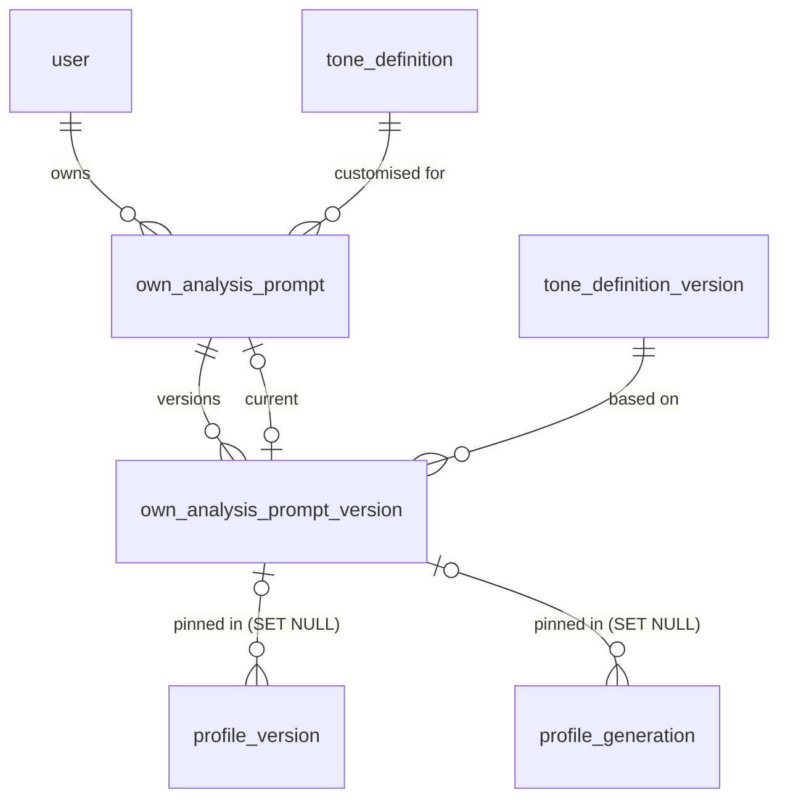

# Data Model: Voice Analysis Prompt

Feature: `002-voice-analysis-prompt`. Store: PostgreSQL 17 through Drizzle (`@voicespark/db`). This document is a delta on `specs/001-personal-brand-voice/data-model.md`. Everything not named here is unchanged.

## Conventions

- Same conventions as 001: snake_case, `uuid` ids, `timestamptz` timestamps, `_enc` columns are AES-GCM ciphertext and content-class.
- New user-owned tables use `ON DELETE CASCADE` from `user`.
- "FR" and "SC" references point at `specs/002-voice-analysis-prompt/spec.md`.
- Character limits count JavaScript string length on write and `char_length` in SQL CHECKs.

## Summary of changes

| Kind | Object |
|---|---|
| Altered table | `tone_definition_version` (+`analysis_prompt`; `dimensions` gets default `'[]'`) |
| Altered table | `profile_version` (+`format`, `prompt_source`, `own_prompt_version_id`) |
| Altered table | `profile_generation` (+`own_prompt_version_id`) |
| Altered constraint | `notification_type_check` (+`analysis_prompt_default_changed`) |
| New table | `own_analysis_prompt` |
| New table | `own_analysis_prompt_version` |
| New enum | `profile_version_format` |
| New enum | `analysis_prompt_source` |
| New audit actions | `analysis_prompt.customised`, `analysis_prompt.saved`, `analysis_prompt.reset`, `profile.document_edited` |
| Migration | `0007_analysis_prompts.sql` plus a TypeScript post-migrate backfill |

## Altered tables

### tone_definition_version

Existing columns are unchanged: `id`, `definition_id`, `version_number`, `status`, `name`, `description`, `dimensions`, `created_by`, `created_at`, `published_by`, `published_at`.

| Field | Change | Type | Constraints |
|---|---|---|---|
| analysis_prompt | added | text | nullable; CHECK `analysis_prompt is null or char_length(analysis_prompt) <= 20000` (`tone_definition_version_analysis_prompt_len`) |
| dimensions | default added | jsonb | still `not null`; default `'[]'` |

Rules:
- The default analysis prompt of a definition is the `analysis_prompt` of its active version. The default version id is the active definition version id (FR-001 to FR-003).
- Drafts may hold a null, empty or partial prompt. Publish and rollback need a non-empty trimmed prompt of at most 20,000 characters (FR-001, FR-002). The service returns `422 validation_failed` with `field: 'analysisPrompt'`.
- Publish, rollback, draft, history and diff reuse the 001 version machinery. `diff()` gains an `analysisPrompt` entry (FR-002).
- `dimensions` becomes read-only. Create and update-draft reject a `dimensions` field with `422 validation_failed`, `field: 'dimensions'`. `createDraft` copies `dimensions` from the source version. New definitions store `[]`. Existing versions keep their dimensions (legacy profiles still read them, FR-024).
- The zod `dimensionsSchema` (1 to 20 entries) stays for legacy input and the adapter. It no longer guards writes, so `[]` is valid in the column.
- The partial unique indexes from 001 (one draft, one active per definition) are unchanged.

### profile_version

Existing columns are unchanged: `id`, `profile_id`, `version_number`, `origin`, `based_on_version_id`, `definition_version_id`, `prompt_version_id`, `body_enc`, `feedback_enc`, `languages`, `contributing_source_ids`, `contributing_item_count`, `rating`, `rated_at`, `created_at`.

| Field | Change | Type | Constraints |
|---|---|---|---|
| format | added | profile_version_format (`structured`, `document`) | not null; default `structured` |
| prompt_source | added | analysis_prompt_source (`default`, `own`) | nullable; null for legacy rows |
| own_prompt_version_id | added | uuid | nullable; fk `own_analysis_prompt_version`, `ON DELETE SET NULL` |

Rules:
- Existing rows get `format = 'structured'` and a null `prompt_source`. They are legacy versions and stay readable (FR-024, SC-006).
- A `document` version holds a `VoiceDocument` in `body_enc` (see "TypeScript shapes").
- `origin` is unchanged. A direct edit of a document uses `manual_edit` and keeps `prompt_source` and `own_prompt_version_id` from the base version.
- Check `profile_version_prompt_source_consistent`: `prompt_source = 'own'` is required when `own_prompt_version_id` is not null. `prompt_source = 'own'` with a null `own_prompt_version_id` is allowed only after the own version was removed (`SET NULL` on account deletion cascades the row away anyway). Reads treat that case as "own prompt no longer available".
- `definition_version_id` stays not null. It records the definition version whose default prompt applied, or whose version the own prompt was based on at request time (FR-018, FR-019).
- `prompt_version_id` still points at the `tone_profile.generate` or `tone_profile.feedback` template version. It is null for `manual_edit`.
- Versions stay immutable except `rating` and `rated_at` (as in 001). `scrubDeletedExcerpts` is the one exception: it rewrites `body_enc` to drop excerpts of deleted sources. See "Deletion behaviour".

### profile_generation

Existing columns are unchanged, including `definition_version_id` and `prompt_version_id` (both not null).

| Field | Change | Type | Constraints |
|---|---|---|---|
| own_prompt_version_id | added | uuid | nullable; fk `own_analysis_prompt_version`, `ON DELETE SET NULL` |

Rules:
- Pinned at request time, with the other pins (FR-019). A later save, reset or publish does not change a queued or running generation.
- Null means the default prompt applies.
- See "Generation pin resolution".

### notification

The `type` column stays `text`. `NOTIFICATION_TYPES` in `packages/db/src/schema/notifications.ts` gains `analysis_prompt_default_changed`. The migration drops and recreates `notification_type_check` with the new value added to the list in 001.

Payload for the new type (ids only, FR-012):

```json
{ "definitionId": "…", "ownPromptId": "…", "fromDefinitionVersionId": "…", "toDefinitionVersionId": "…" }
```

It is in-app only. It is not in `EMAILED_NOTIFICATION_TYPES`.

### audit_log_entry

No column change. `AUDIT_ACTIONS` gains:
- `analysis_prompt.customised`
- `analysis_prompt.saved`
- `analysis_prompt.reset`
- `profile.document_edited`

Metadata for the three `analysis_prompt.*` actions is `{ownPromptId, versionId, basedOnDefinitionVersionId, charCount}`. It never holds prompt text (FR-026). Actor type is `user`; target type is `definition`; target id is the definition id.

Existing actions `definition.version_published` and `definition.rolled_back` gain metadata `{analysisPromptChanged: boolean, notifiedUsers: number}`.

## New enums

| Enum | Values | Used by |
|---|---|---|
| profile_version_format | `structured`, `document` | `profile_version.format` |
| analysis_prompt_source | `default`, `own` | `profile_version.prompt_source` |

TypeScript: `PROFILE_VERSION_FORMATS` and `ANALYSIS_PROMPT_SOURCES` in `packages/db/src/schema/enums.ts`, with `pgEnum` wrappers, as for the other enums.

## New tables

### own_analysis_prompt

One row per user per definition. It holds state only. The text lives in the version table.

| Field | Type | Constraints |
|---|---|---|
| id | uuid | pk, default random |
| user_id | uuid | not null; fk `user`, `ON DELETE CASCADE` |
| definition_id | uuid | not null; fk `tone_definition` (no cascade) |
| in_use | bool | not null; default true |
| current_version_id | uuid | nullable; fk `own_analysis_prompt_version`, `ON DELETE SET NULL` |
| created_at, updated_at | timestamptz | not null; default now |

Indexes and constraints:
- Unique `own_analysis_prompt_user_definition_uq` on `(user_id, definition_id)`.
- Index `own_analysis_prompt_definition_in_use_idx` on `(definition_id)` where `in_use`. It serves the admin count and the default-change fan-out.
- CHECK `own_analysis_prompt_in_use_has_version`: `not in_use or current_version_id is not null`.

Notes:
- `current_version_id` is nullable because the row is inserted before its first version. The service creates both in one transaction and sets the pointer last.
- The row holds no content, so admin counts may read it (D5).

### own_analysis_prompt_version

Immutable. Every save inserts a row.

| Field | Type | Constraints |
|---|---|---|
| id | uuid | pk, default random |
| own_prompt_id | uuid | not null; fk `own_analysis_prompt`, `ON DELETE CASCADE` |
| version_number | int | not null; starts at 1 |
| prompt_text_enc | text | not null; AES-GCM `user-content` ciphertext (content-class) |
| char_count | int | not null; CHECK `char_count between 1 and 20000` |
| based_on_definition_version_id | uuid | not null; fk `tone_definition_version` (no cascade) |
| created_at | timestamptz | not null; default now |

Indexes and constraints:
- Unique `own_analysis_prompt_version_number_uq` on `(own_prompt_id, version_number)`.
- Index on `(own_prompt_id)`.

Notes:
- `char_count` is stored in clear so the service and audit can report a count without decrypting. It is not a secret.
- The text limit is checked in the service on the plaintext (FR-011). The CHECK on `char_count` is a backstop.
- `based_on_definition_version_id` references a published (active or superseded) definition version. Those rows are never deleted, so no cascade is needed. Only drafts can be discarded, and a draft is never a base.

## Relationships



## Own-prompt state machine

States per `(user, definition)`:

| State | Row | `in_use` | Meaning |
|---|---|---|---|
| none | no `own_analysis_prompt` row | n/a | the user uses the default |
| own | row with a current version | true | the user's prompt applies |
| reset | row, versions kept | false | the default applies again; history kept |

Transitions:

| From | Action | To | Effect |
|---|---|---|---|
| none | customise | own | insert row and version 1, copied from the active default text; `based_on` = active definition version; audit `analysis_prompt.customised` |
| own | save | own | insert version n+1 with the new text; `based_on` inherited from the previous current version; audit `analysis_prompt.saved` |
| own | reset | reset | `in_use = false`; no version deleted; audit `analysis_prompt.reset` |
| reset | customise | own | insert a new version from a fresh copy of the current default; `in_use = true`; `based_on` = active definition version |
| reset | save | own | same as customise, with the submitted text; `based_on` = active definition version |
| own | customise | own | refused: `409 conflict` |

Rules:
- Customise, save and reset are refused with `409 definition_retired` when the definition is retired, and `404 not_found` when the user has not chosen it (FR-006 to FR-008). Reset is allowed for a retired definition so a user can leave own mode.
- Save checks `baseVersionId` against `current_version_id`. A mismatch is `409 conflict`.
- Save validates the text: trimmed length 1 to 20,000, else `422 validation_failed` with `field: 'promptText'`, `reason: 'empty' | 'too_long'`, `maxChars: 20000`.
- The text is not inspected at save. It is inspected before every use in a generation (see the design's layer 3). This keeps save free of LLM calls.
- Each transition runs in one transaction with `SELECT … FOR UPDATE` on the `own_analysis_prompt` row.

## Generation pin resolution

Done inside the `createGenerations` transaction in `packages/core/src/services/profiles.ts`.

1. Lock the `tone_profile` row and the active `tone_definition_version` of the definition. The pin `definition_version_id` is the active version id.
2. Select the user's `own_analysis_prompt` for `(user_id, definition_id)` with `FOR UPDATE`.
3. If a row exists and `in_use` is true, the pin `own_prompt_version_id` is `current_version_id`. Otherwise it is null.
4. Pin `prompt_version_id` to the active `tone_profile.generate` or `tone_profile.feedback` template version, as in 001.
5. Insert the `profile_generation` row with all three pins.

The worker then reads only the pinned ids:
- `own_prompt_version_id` set: decrypt the own text, inspect it under the current filter policy, wrap it as `source="own"`.
- `own_prompt_version_id` null: read `analysis_prompt` of the pinned `definition_version_id`, wrap it as `source="default"`.

On success, `storeGeneratedVersion` writes `format = 'document'`, `prompt_source` (`own` or `default`), `own_prompt_version_id`, `definition_version_id` and `prompt_version_id` on the new `profile_version` (FR-019, FR-024).

Edge cases:
- A save or reset after the pin does not affect the running generation.
- A publish after the pin does not affect the running generation. The next generation uses the new default (SC-001).
- If the pinned own version is gone when the worker runs (account deletion race), the worker fails the generation with `analysis_prompt_missing`. It never falls back silently.

## Content-class columns (delta)

Additions to the 001 table. Admin repositories never select these.

| Table | Column | Holds |
|---|---|---|
| own_analysis_prompt_version | prompt_text_enc | the user's own analysis prompt text |
| profile_version | body_enc | now also holds a `VoiceDocument` (summary, sections, do/don't, excerpts) for `format = 'document'` |

Not content-class:
- `tone_definition_version.analysis_prompt` is admin configuration. It is plaintext and admin-readable (FR-001).
- `own_analysis_prompt` (state only), `own_analysis_prompt_version.char_count`, `based_on_definition_version_id` and `version_number` are metadata.
- Admin views get `ownPromptCount` (count of rows where `in_use`, per definition) and nothing else about own prompts (FR-005). No admin route reads `own_analysis_prompt_version` or document bodies.
- Notification payloads and audit metadata hold ids and counts only.

## TypeScript shapes

Defined in `packages/core/src/prompting/document-schema.ts`. Zod schemas are strict.

```ts
/** Persisted in profile_version.body_enc when format = 'document'. */
export interface VoiceDocument {
  aspects: { key: string; name: string }[];       // 1-20; key ^[a-z][a-z0-9_]{1,40}$, unique; name <= 80
  summary: string;                                // 1-1200
  sections: {
    aspectKey: string;                            // exactly one section per aspect
    heading: string;                              // <= 120
    markdown: string;                             // <= 4000, safe subset
  }[];
  doList: string[];                               // 1-10 items, each <= 200
  dontList: string[];                             // 1-10 items, each <= 200
  excerpts: {
    text: string;                                 // <= 300, verbatim from an authored sample
    sampleRef: string;                            // ^A\d+$ at generation time
    contentItemId: string;                        // mapped server-side, never from the model
    aspectKeys: string[];
  }[];                                            // 3-12 when stored by generation; may shrink after a source is deleted
  languages: { code: string; share: number }[];
}

/** What the model returns. Same as VoiceDocument without contentItemId. */
export interface DocumentOutput {
  aspects: VoiceDocument['aspects'];
  summary: string;
  sections: VoiceDocument['sections'];
  doList: string[];
  dontList: string[];
  excerpts: { text: string; sampleRef: string; aspectKeys: string[] }[]; // 3-12
  languages: VoiceDocument['languages'];
}

/** What GET /api/profiles/{id}/versions/{versionId} returns for the body. */
export type VersionBodyView =
  | { format: 'structured'; body: ProfileBody }       // legacy, unchanged shape
  | { format: 'document'; body: VoiceDocument };

export interface ExcerptSource {
  kind: ContentKind;
  itemDate: string;                                    // ISO date
  sourceLabels: string[];                              // connected_source.account_label values
}

export interface VersionView {
  id: string;
  versionNumber: number;
  origin: ProfileVersionOrigin;
  createdAt: string;
  rating: ProfileRating | null;
  format: 'structured' | 'document';
  body: ProfileBody | VoiceDocument;
  promptSource: 'default' | 'own' | null;
  analysisPrompt:
    | { kind: 'default'; definitionVersion: { id: string; versionNumber: number } }
    | { kind: 'own'; ownVersion: { id: string; versionNumber: number } }
    | null;
  excerptSources: Record<string, ExcerptSource | null>; // key = contentItemId; null = source deleted
}
```

Validation rules enforced by `postValidateDocument`:

| Rule | Problem code | FR / SC |
|---|---|---|
| every aspect has exactly one section | `aspect_missing:{key}` | FR-015, SC-003 |
| no duplicate section for an aspect | `aspect_duplicate` | FR-015, SC-003 |
| no section names an unknown aspect | `section_unknown` | FR-015 |
| summary non-empty | `summary_missing` | FR-016, FR-021 |
| do list and don't list non-empty | `do_list_empty`, `dont_list_empty` | FR-016, FR-021 |
| at least 3 excerpts are whitespace-normalised verbatim substrings of an authored sample | `too_few_excerpts`, `excerpt_dropped:{i}` | FR-016, FR-017 |
| no 8-word run of summary, section, do or don't text appears in received context unless it also appears in an authored sample | `received_quote` | FR-010, SC-004 |

Markdown subset: paragraphs, `-` and `1.` lists, `**bold**`, `*italic*`, `###` headings. Raw HTML, links and images render as literal text. They are not rejected.

## Migration 0007

File: `packages/db/drizzle/0007_analysis_prompts.sql`, generated by `drizzle-kit generate` with hand-written edits for CHECKs and enum creation. Journal entry in `packages/db/drizzle/meta`.

SQL steps, in order:
1. `CREATE TYPE profile_version_format`, `CREATE TYPE analysis_prompt_source`.
2. `ALTER TABLE tone_definition_version ADD COLUMN analysis_prompt text`, add the length CHECK, `ALTER COLUMN dimensions SET DEFAULT '[]'::jsonb`.
3. `CREATE TABLE own_analysis_prompt` and `own_analysis_prompt_version` with indexes, then add the `current_version_id` FK (circular, added last).
4. `ALTER TABLE profile_version ADD COLUMN format … DEFAULT 'structured'`, `prompt_source`, `own_prompt_version_id` with FK and consistency CHECK.
5. `ALTER TABLE profile_generation ADD COLUMN own_prompt_version_id` with FK.
6. Drop and recreate `notification_type_check` with `analysis_prompt_default_changed`.

Backfill (TypeScript, FR-025). New file `packages/db/src/data/analysis-prompts.ts`:
- `buildAnalysisPromptFromDimensions({name, description, dimensions})` returns the prompt text. It starts "Analyse how {firstName} writes for "{name}". {description} Write one section for each aspect below …" and adds one line per dimension (name, description, value guidance, guidance).
- `backfillAnalysisPrompts(db)` runs in one transaction:
  1. For every `tone_definition_version` where `analysis_prompt is null` (active and superseded, so rollback stays valid), set `analysis_prompt` from the builder. Drafts too.
  2. For `tone_profile.generate` and `tone_profile.feedback`: if the active version lacks `{{analysisPrompt}}`, insert a new active version (v2) with the document-oriented templates, model and effort from the previous version, `max_tokens` 16000, actor nil uuid. Supersede the old version. Add a `version_activation` row (action `publish`).
- `packages/db/src/migrate.ts` calls `backfillAnalysisPrompts(db)` right after the drizzle `migrate()` call.
- Idempotent: both steps filter on "not yet done". A second run changes nothing.
- A fresh database: migrate runs, the backfill finds nothing, then `seed.ts` inserts the new templates as v1 and sets `analysis_prompt` through the same builder.
- Existing `profile_version` rows are not rewritten. They stay `structured` (FR-024, SC-006).
- Rollback to the dimension-based template v1 is blocked by design. The new variable whitelist rejects it with `unknown_template_variable`.

## Deletion behaviour

Account deletion (cascade rules from 001):
- `user` row removal cascades to `own_analysis_prompt`, then `own_analysis_prompt_version`.
- `profile_version` and `profile_generation` rows go through `tone_profile` and `user` cascades. Their `own_prompt_version_id` FKs are `SET NULL`, which cannot block the cascade.
- Audit entries `analysis_prompt.*` stay with `actor_user_id` set null. `audit.pseudonymize` runs as in 001. They hold no text.

Source or item deletion (FR-023):
- `scrubDeletedExcerpts(tx, userId, itemIds)` in the profiles service runs from `purgeItems` finalize and from `deleteSource`.
- It decrypts every `profile_version.body_enc` of that user. It drops `excerpts` whose `contentItemId` is in the deleted set, then re-encrypts with the active key.
- It covers both formats. Legacy `structured` bodies carry excerpts too. A stored version may end with `excerpts: []`.
- If the latest version of a profile changed, set `tone_profile.outdated_reason = 'sources_deleted'` and notify `profile_outdated`, which offers regeneration.
- `excerptSources` in the version view resolves each `contentItemId` through `content_item`, `content_item_occurrence` and `connected_source`. A missing item gives `null`. The UI shows "source deleted" and does not link.

Definition retirement:
- Own prompts and their versions stay. The user can view them and reset. Customise and save are refused (`definition_retired`).

Admin discard of a draft:
- Draft versions carry no own-prompt reference, so discard is unchanged.

## FR traceability

| FR | Entities and rules |
|---|---|
| FR-001, FR-002 | `tone_definition_version.analysis_prompt`, version machinery, `diff()` |
| FR-003 | the active version's `analysis_prompt` is the default; pin resolution |
| FR-004 | preview does not touch these tables (render-only, and a job with synthetic samples) |
| FR-005 | `own_analysis_prompt` holds state only, `ownPromptCount`, content-class table |
| FR-006 to FR-008 | `own_analysis_prompt` state machine, `own_analysis_prompt_version`, `prompt_text_enc` |
| FR-009 | only the analysis prompt has a user-owned table; draft and feedback templates stay admin-only |
| FR-010 | `postValidateDocument` (`received_quote`), input and output inspection |
| FR-011 | `char_count` CHECK, service validation, 20,000-char limit |
| FR-012 to FR-014 | notification type and payload, `in_use` index, `based_on_definition_version_id` |
| FR-015, FR-016 | `VoiceDocument`, `postValidateDocument` |
| FR-017 | excerpts verbatim from authored samples, `contentItemId` mapped server-side |
| FR-018 | `profile_version` `prompt_source`, `own_prompt_version_id`, `definition_version_id`, `prompt_version_id` |
| FR-019 | `profile_generation` pins |
| FR-020 | `profile_version.origin = 'manual_edit'`, `profile.document_edited` audit |
| FR-021 | invalid output stores no `profile_version` row |
| FR-022 | draft processor reads either format through `decryptVersionBody` |
| FR-023 | unchanged 001 rules; `scrubDeletedExcerpts` and the cascade rules in "Deletion behaviour" |
| FR-024 | `profile_version.format`, `structuredToDocument` adapter |
| FR-025 | migration 0007 and backfill |
| FR-026 | `analysis_prompt.*` audit actions, ids and counts only |
| SC-001 | pin resolution reads the active definition version uncached |
| SC-003 | aspect checks |
| SC-004 | `received_quote` check, excerpt verbatim check |
| SC-005 | inline fan-out in `definitions.activate()` |
| SC-006 | legacy rows untouched, adapter |
| SC-007 | content-class columns, admin isolation |
