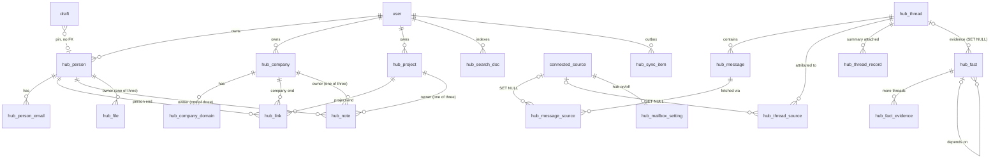

# Data Model: Context Hub

Feature: `003-context-hub`. Store: PostgreSQL 17 through Drizzle (`@voicespark/db`). This document is a delta on `specs/001-personal-brand-voice/data-model.md` and `specs/002-voice-analysis-prompt/data-model.md`. Everything not named here is unchanged.

## Conventions

- Same conventions as 001: snake_case, `uuid` ids, `timestamptz` timestamps, `_enc` columns are content-class ciphertext.
- Every new table has `user_id uuid not null` with `fk user ON DELETE CASCADE`, and every query is owner-scoped. Child tables repeat `user_id` so the scope check needs no join.
- `_enc` columns use the `user-content` key purpose and the text envelope `v1.kid.iv.tag.ct`. File blobs use the new `hub-files` purpose and a binary envelope (see "Files and blob store").
- `*_key`, `*_hash` and `tokens` columns are keyed HMACs (`hmacHex()`, `DEDUP_HMAC_KEY`). They are per user, because the user id is part of every HMAC input. They are not content-class.
- Plaintext columns are limited to ids, enums, dates, counts, booleans and keyed HMACs.
- "FR", "SC" and "AS" references point at `specs/003-context-hub/spec.md`.
- Length limits count JavaScript string length on write. SQL CHECKs use `char_length` only where the column is plaintext.
- All new tables and enums live in `packages/db/src/schema/hub.ts` and `enums.ts`.

## Summary of changes

| Kind | Object |
|---|---|
| Altered table | `draft` (+`hub_record_kind`, `hub_record_id`, `hub_record_label_enc`, `hub_context_status`) |
| Altered enum | `deletion_scope` (+`hub_source`) |
| Altered list | `AUDIT_ACTIONS` (+ hub actions) |
| Altered type | `KeyPurpose` (+`'hub-files'`) |
| New tables, records | `hub_person`, `hub_person_email`, `hub_company`, `hub_company_domain`, `hub_project`, `hub_link` |
| New tables, content | `hub_note`, `hub_file` |
| New tables, mail | `hub_thread`, `hub_message`, `hub_message_source`, `hub_thread_source`, `hub_thread_record`, `hub_llm_call` |
| New tables, findings | `hub_fact`, `hub_fact_evidence`, `hub_block_marker`, `hub_ignore_rule`, `hub_merge_redirect` |
| New tables, state | `hub_mailbox_setting`, `hub_search_doc`, `hub_sync_item` |
| New enums | `hub_origin`, `hub_project_status`, `hub_link_kind`, `hub_extraction_status`, `hub_thread_status`, `hub_skip_reason`, `hub_fact_type`, `hub_fact_state`, `hub_fact_basis`, `hub_sync_status`, `hub_sync_entity` |
| Migration | `0008_context_hub.sql` (latest existing is `0007_analysis_prompts.sql`) |

## New enums

| Enum | Values | Used by |
|---|---|---|
| hub_origin | `user`, `email` | `created_from`, `origin` columns |
| hub_project_status | `planned`, `active`, `on_hold`, `completed` | `hub_project.status` |
| hub_link_kind | `person_company`, `person_project`, `company_project` | `hub_link.kind` |
| hub_extraction_status | `pending`, `extracted`, `empty`, `unsupported`, `failed`, `excluded` | `hub_file.extraction_status` |
| hub_thread_status | `pending`, `done`, `skipped`, `failed` | `hub_thread.status` |
| hub_skip_reason | `automated`, `automated_llm`, `ignored`, `owner_only`, `no_candidates`, `irrelevant`, `unavailable`, `excluded` | `hub_thread.skip_reason` |
| hub_fact_type | `person`, `person_email`, `company`, `company_domain`, `project`, `field`, `link`, `link_role` | `hub_fact.type` |
| hub_fact_state | `applied`, `suggested`, `rejected`, `overridden`, `superseded` | `hub_fact.state` |
| hub_fact_basis | `header`, `domain`, `signature`, `text` | `hub_fact.basis` |
| hub_sync_status | `pending`, `stored`, `failed` | `hub_sync_item.status` |
| hub_sync_entity | `person`, `company`, `project`, `note`, `file`, `summary` | `hub_sync_item.entity_type` |

Columns the design lists as plain value sets without an enum name (`direction`, `language`, `purpose`, `reason`, `kind` on rules, `data_choice`, `backfill_state`, `item_type`, `owner_kind`) are `text` with a CHECK listing the values. They are named below.

TypeScript: `HUB_*` const arrays in `packages/db/src/schema/enums.ts` with `pgEnum` wrappers, as for the other enums.

## Altered tables

### draft

Existing columns are unchanged.

| Field | Change | Type | Constraints |
|---|---|---|---|
| hub_record_kind | added | text | nullable; CHECK `in ('person','company','project')` |
| hub_record_id | added | uuid | nullable; no FK, so the pin survives record deletion |
| hub_record_label_enc | added | text | nullable; content-class; the record name at creation |
| hub_context_status | added | text | nullable; CHECK `in ('used','missing','inspection_failed')`; set by the draft worker |

Rules:
- All three are set together or all are null. CHECK `draft_hub_record_all_or_none` (FR-027).
- The service checks that the record belongs to the user before it stores the pin. A foreign id returns 404.
- The label is shown in the draft list and detail even after the record is deleted (AS6.3).
- Regenerate copies the three columns to the new draft.
- If the record is gone when the worker runs, the draft runs without context and sets `hub_context_status = 'missing'`. It is not an error.

### deletion_scope enum

Gains `hub_source`. A request with this scope has `target_id = sourceId`. See "Deletion behaviour".

### audit_log_entry

No column change. `AUDIT_ACTIONS` gains the actions below. Metadata holds ids and counts only (FR-032). It never holds names, values or text.

| Action | Metadata |
|---|---|
| `hub.mailbox_enabled` | `{sourceId, consentTextVersion}` |
| `hub.mailbox_disabled` | `{sourceId, hubData}` |
| `hub.mailbox_data_deleted` | `{sourceId, threads, records, links, values}` (counts; values = cleared fields + deleted emails/domains) |
| `hub.record_deleted` | `{kind, notes, files, links}` |
| `hub.records_merged` | `{kind}` |
| `hub.suggestions_bulk_decided` | `{accepted, rejected, failed}` |
| `hub.ignore_rule_created`, `hub.ignore_rule_deleted` | `{kind}` |
| `hub.resync_requested` | `{items}` |
| `hub.file_excluded` | `{category}` |

Actor type is `user` (or `system` for purge jobs). Target type is `hub`.

### KeyPurpose

`'mailbox-credentials' | 'user-content' | 'upload-staging'` gains `'hub-files'` in `packages/core/src/crypto/keyring.ts`. The HKDF subkey is derived the same way as for the other purposes.

## New tables: records

### hub_person

| Field | Type | Constraints |
|---|---|---|
| id | uuid | pk, default random |
| user_id | uuid | not null; fk `user`, cascade |
| name_enc | text | not null; content-class; 1..200 chars |
| name_key | char(64) | not null; HMAC of `hubname:{uid}:person:{lower(trim(name))}` |
| match_key | char(64) | not null; HMAC of the folded name (diacritics folded) |
| role_title_enc | text | nullable; content-class; <= 200 |
| phone_enc | text | nullable; content-class; <= 50; plaintext matches `^[0-9+()\-.\s/x]*$` |
| description_enc | text | nullable; content-class; <= 2000 |
| owner_fields | text[] | not null; default `'{}'` |
| created_from | hub_origin | not null; default `user` |
| created_at, updated_at | timestamptz | not null; default now |

Indexes:
- `hub_person_user_name_key_idx` on `(user_id, name_key)` (FR-003 warning).
- `hub_person_user_match_key_idx` on `(user_id, match_key)` (extraction matching).
- `hub_person_user_updated_idx` on `(user_id, updated_at desc)` (sort by last change in SQL).

### hub_person_email

| Field | Type | Constraints |
|---|---|---|
| id | uuid | pk |
| user_id | uuid | not null; fk `user`, cascade |
| person_id | uuid | not null; fk `hub_person`, cascade |
| address_enc | text | not null; content-class; lower-cased; <= 320 chars |
| address_hash | char(64) | not null; HMAC of the lower-cased address |
| match_hash | char(64) | not null; HMAC of the address with a `+tag` stripped |
| is_primary | bool | not null; default false |
| origin | hub_origin | not null |
| created_at | timestamptz | not null; default now |

Indexes and constraints:
- Unique `hub_person_email_user_address_uq` on `(user_id, address_hash)`. One address belongs to one person.
- Unique partial `hub_person_email_primary_uq` on `(person_id)` where `is_primary`.
- Index on `(user_id, match_hash)` and on `(person_id)`.

### hub_company

| Field | Type | Constraints |
|---|---|---|
| id, user_id | uuid | as `hub_person` |
| name_enc | text | not null; content-class; 1..200 |
| name_key | char(64) | not null; as `hub_person`, with `company` |
| match_key | char(64) | not null; folded name with a legal suffix stripped |
| website_enc | text | nullable; content-class; http(s) URL; a bare domain is stored as `https://...` |
| industry_enc | text | nullable; content-class; <= 200 |
| description_enc | text | nullable; content-class; <= 2000 |
| owner_fields | text[] | not null; default `'{}'` |
| created_from | hub_origin | not null; default `user` |
| created_at, updated_at | timestamptz | not null; default now |

The legal suffix list is `sp. z o.o., s.a., sp.k., sp.j., s.c., ltd, limited, llc, inc, gmbh, ag, bv, plc, corp, co`. It lives in `packages/core/src/hub/normalize.ts`.

Indexes: same three as `hub_person`, with `hub_company_` names.

### hub_company_domain

| Field | Type | Constraints |
|---|---|---|
| id, user_id | uuid | as above |
| company_id | uuid | not null; fk `hub_company`, cascade |
| domain_enc | text | not null; content-class |
| domain_hash | char(64) | not null; HMAC of the domain |
| origin | hub_origin | not null |
| created_at | timestamptz | not null |

Rules and indexes:
- The domain is lower-cased, has no `www.` prefix and matches `^(?=.{1,253}$)([a-z0-9-]{1,63}\.)+[a-z]{2,63}$`.
- Unique `hub_company_domain_user_hash_uq` on `(user_id, domain_hash)`.
- Index on `(company_id)`.

### hub_project

| Field | Type | Constraints |
|---|---|---|
| id, user_id | uuid | as above |
| name_enc | text | not null; content-class; 1..200 |
| name_key | char(64) | not null |
| match_key | char(64) | not null; folded name with leading `project`, `projekt`, `the` stripped |
| status | hub_project_status | not null; default `planned` |
| start_date, end_date | date | nullable; metadata, not content |
| description_enc | text | nullable; content-class; <= 2000 |
| owner_fields | text[] | not null; default `'{}'` |
| created_from | hub_origin | not null; default `user` |
| created_at, updated_at | timestamptz | not null |

Constraints: CHECK `hub_project_dates_order`: `end_date is null or start_date is null or end_date >= start_date` (FR-002). Indexes as for `hub_person`.

### hub_link

| Field | Type | Constraints |
|---|---|---|
| id, user_id | uuid | as above |
| kind | hub_link_kind | not null |
| person_id | uuid | nullable; fk `hub_person`, cascade |
| company_id | uuid | nullable; fk `hub_company`, cascade |
| project_id | uuid | nullable; fk `hub_project`, cascade |
| role_enc | text | nullable; content-class; <= 100 |
| role_owner_set | bool | not null; default false |
| origin | hub_origin | not null |
| created_at, updated_at | timestamptz | not null |

Constraints:
- CHECK `hub_link_kind_fks`: exactly the two FKs that match `kind` are non-null (`person_company` uses person and company, and so on).
- Three partial unique indexes, one per kind: `(user_id, person_id, company_id) where kind = 'person_company'`, `(user_id, person_id, project_id) where kind = 'person_project'`, `(user_id, company_id, project_id) where kind = 'company_project'`. This gives at most one link per pair (FR-007).
- Indexes on each FK column.

Rules:
- A same-kind pair (person to person, and so on) is rejected with `409 invalid_link`. A duplicate pair returns `409 link_exists` with `{linkId}`.
- `role_owner_set` is true once the user sets or clears the role. Email findings then become conflicts (FR-016).
- The link shows on both records (FR-007). The service reads it from either end.

## New tables: notes and files

### hub_note

| Field | Type | Constraints |
|---|---|---|
| id, user_id | uuid | as above |
| person_id, company_id, project_id | uuid | nullable; fk to the record table, cascade |
| title_enc | text | not null; content-class; <= 300 chars |
| body_json_enc | text | not null; content-class; ProseMirror JSON |
| redacted_values | int | not null; default 0 |
| created_at, updated_at | timestamptz | not null |

Constraints and indexes:
- CHECK `hub_note_one_owner`: `num_nonnulls(person_id, company_id, project_id) = 1`.
- Indexes on `(person_id, updated_at desc)`, `(company_id, updated_at desc)`, `(project_id, updated_at desc)`.

Rules:
- Only the latest version is stored. There is no note history.
- Body limits: <= 1 MB serialised, <= 100,000 text characters (FR-008).
- Validation is `getSchema(extensions)`, `Node.fromJSON(...).check()`, then an allowlist walk (see "Rich-text note shape").
- Title, text nodes and link hrefs pass `inspectSegments` under the full user policy before storing. A whole-item exclusion refuses the save with `422 note_excluded` and the category (FR-028).
- `redacted_values` counts redactions shown to the user.

### hub_file

| Field | Type | Constraints |
|---|---|---|
| id, user_id | uuid | as above |
| person_id, company_id, project_id | uuid | nullable; fk, cascade |
| name_enc | text | not null; content-class; <= 255; no `/`, `\` or control chars |
| description_enc | text | nullable; content-class; <= 2000 |
| mime_type | text | not null; from the magic-byte sniff |
| extension | text | not null; from the allowlist |
| size_bytes | bigint | not null; CHECK `size_bytes between 0 and 26214400` |
| sha256 | char(64) | not null; hash of the plaintext |
| storage_key | uuid | not null; unique |
| key_id | text | not null; keyring kid used for the blob |
| extraction_status | hub_extraction_status | not null; default `pending` |
| extraction_reason | text | nullable; reason code |
| extracted_text_enc | text | nullable; content-class; filtered text, <= 1,000,000 chars |
| redacted_values | int | not null; default 0 |
| created_at, updated_at | timestamptz | not null |

Constraints and indexes:
- CHECK `hub_file_one_owner`: `num_nonnulls(person_id, company_id, project_id) = 1`.
- Unique `hub_file_storage_key_uq` on `(storage_key)`.
- Indexes on each owner FK and on `(user_id, extraction_status)`.

Reason codes in `extraction_reason`: `no_text_extraction_for_type`, `image_not_searchable`, `empty`, `timeout`, `corrupt`, `inspection_failed` (status `failed`), and the filter category key when status is `excluded`.

Rules:
- Allowed extensions (20): pdf, docx, odt, doc, rtf, xlsx, ods, csv, xls, pptx, odp, ppt, txt, md, markdown, png, jpg, jpeg, gif, webp. SVG is refused.
- Over 25 MB is `413 too_large`. A wrong type is `415 unsupported_type` with the allowed list (FR-009).
- Extraction runs in the worker (`hub.file-extract`, 30 s timeout). The row is created with `pending`.
- `pdf`, `docx`, `xlsx`, `pptx`, `odt`, `ods`, `odp`, `csv`, `txt`, `md` can reach `extracted`. `rtf`, `doc`, `xls`, `ppt` give `unsupported` / `no_text_extraction_for_type`. Images give `unsupported` / `image_not_searchable` (FR-010).
- Extracted text passes `inspectForUser` (kind `file`, full policy) before it is stored, indexed or synced. A whole-item exclusion sets `excluded`, discards the text and writes the audit entry `hub.file_excluded`.
- The blob is kept unmodified (see spec Clarifications, FR-009). Only derived text is filtered.

## New tables: mail threads

### hub_thread

One row per conversation per user. It holds no body column (SC-008).

| Field | Type | Constraints |
|---|---|---|
| id, user_id | uuid | as above |
| thread_key | char(64) | not null; HMAC `hubthread:{userId}:{root}` |
| subject_enc | text | nullable; content-class |
| participants_enc | text | nullable; content-class; JSON, see "Thread participants shape" |
| first_message_at, last_message_at | timestamptz | nullable |
| message_count | int | not null; default 0 |
| language | text | nullable; CHECK `in ('pl','en','other')` |
| summary_enc | text | nullable; content-class; <= 800 chars |
| summary_version | int | not null; default 0 |
| summary_updated_at | timestamptz | nullable |
| status | hub_thread_status | not null; default `pending` |
| skip_reason | hub_skip_reason | nullable |
| version | bigint | not null; default 1 |
| processed_version | bigint | not null; default 0 |
| attempts | int | not null; default 0 |
| next_attempt_at | timestamptz | nullable |
| locked_until | timestamptz | nullable; lease |
| last_error_code | text | nullable |
| processed_at | timestamptz | nullable |
| created_at | timestamptz | not null |

Constraints and indexes:
- Unique `hub_thread_user_key_uq` on `(user_id, thread_key)`.
- CHECK `hub_thread_processed_le_version`: `processed_version <= version`.
- CHECK `hub_thread_skip_reason_when_skipped`: `skip_reason is null or status = 'skipped'`.
- Index `hub_thread_due_idx` on `(next_attempt_at)` where `status = 'pending'`. It serves `maintenance.hub-thread-sweep`.
- Index on `(user_id, status)` for the failed-thread list and counters.

State machine (`status`):

| From | Event | To | Effect |
|---|---|---|---|
| (new) | first message recorded | pending | `version = 1`, `next_attempt_at = now + 60 s` |
| done, skipped, failed | message with a new `message_id_hash` recorded | pending | `version + 1`, `next_attempt_at = now + 60 s`, `attempts = 0` |
| pending | claimed and processed | done, or pending | only if the lease is still held: `processed_version = claimed version`; `status = CASE WHEN version = claimed version THEN 'done' ELSE 'pending' END`; summary stored. When it stays pending (a message bumped `version` during the run) `next_attempt_at = now()` is kept so the sweep re-claims it |
| pending | skipped by classification, ignore rule, filter or no records | skipped, or pending | `skip_reason` set; `processed_version = claimed version`; no summary; `status = CASE WHEN version = claimed version THEN 'skipped' ELSE 'pending' END`, with `next_attempt_at = now()` when it stays pending |
| pending | no connected hub mailbox holds the messages | pending | retry in 15 min, `attempts` unchanged |
| pending | LLM refusal, or bad output twice, or 8 failed attempts | failed | `next_attempt_at = null`; `last_error_code` set (`llm_refused`, `llm_bad_output`, ...) |
| failed | user retry | pending | `attempts = 0`, `next_attempt_at = now` |

Rules:
- A message already known by `message_id_hash` does not bump `version`. A second mailbox with the same message does not cause reprocessing (FR-020).
- The claim takes a row only when `status = 'pending'`, `version > processed_version` and `next_attempt_at <= now`. The lease is 600 s.
- Backoff is `min(5 s * 2^(n-1), 15 min)` with +/-20% jitter.
- Error codes only. Content never appears in logs or audit.
- Two threads that a new message links are merged into the older one. Messages, sources, facts and records move. The younger summary document is tombstoned in the outbox.

### hub_message

Metadata only. Hashes are per-user HMACs.

| Field | Type | Constraints |
|---|---|---|
| id, user_id | uuid | as above |
| thread_id | uuid | not null; fk `hub_thread`, cascade |
| message_id_hash | char(64) | not null |
| in_reply_to_hash | char(64) | nullable |
| references_hashes | char(64)[] | not null; default `'{}'`; CHECK `cardinality <= 50` |
| sent_at | timestamptz | nullable |
| direction | text | not null; CHECK `in ('inbound','outbound')` |
| is_automated | bool | not null; default false |
| automated_reason | text | nullable; rule code |
| created_at | timestamptz | not null |

Indexes: unique `hub_message_user_hash_uq` on `(user_id, message_id_hash)`; index on `(thread_id)`; index on `(user_id, in_reply_to_hash)`; GIN on `references_hashes` for thread resolution.

Thread resolution on upsert, in order: an existing `hub_message` whose hash is in this message's reference or in-reply-to hashes; the thread key; a new thread. A message with no id gets the synthetic root `source:{sourceId}:{providerRef}`.

### hub_message_source

How thread processing re-fetches a message without a stored body.

| Field | Type | Constraints |
|---|---|---|
| id | uuid | pk |
| user_id | uuid | not null; fk `user`, cascade |
| message_id | uuid | not null; fk `hub_message`, cascade |
| source_id | uuid | nullable; fk `connected_source`, **ON DELETE SET NULL** |
| provider_ref | text | not null |
| folders | text[] | not null; default `'{}'` |
| created_at | timestamptz | not null |

Constraints: unique `hub_message_source_source_ref_uq` on `(source_id, provider_ref)` (Postgres treats null `source_id` rows as distinct); index on `(message_id)` and `(source_id)`.

### hub_thread_source

| Field | Type | Constraints |
|---|---|---|
| id | uuid | pk |
| user_id | uuid | not null; fk `user`, cascade |
| thread_id | uuid | not null; fk `hub_thread`, cascade |
| source_id | uuid | nullable; fk `connected_source`, **ON DELETE SET NULL** |
| web_link_enc | text | nullable; content-class; the provider "open original" URL |

Rules:
- Gmail `#all/{msgid}`, Graph `webLink`, and no link for IMAP (FR-019).
- Unique `(thread_id, source_id)` where `source_id is not null`. Index on `(source_id)`.
- A thread whose rows all point at one source is "exclusive" to it for purge (FR-031).

### hub_thread_record

Attaches a thread summary to every record involved (FR-019).

| Field | Type | Constraints |
|---|---|---|
| id | uuid | pk |
| user_id | uuid | not null; fk `user`, cascade |
| thread_id | uuid | not null; fk `hub_thread`, cascade |
| person_id, company_id, project_id | uuid | nullable; fk to the record, cascade |

Constraints: CHECK `num_nonnulls(person_id, company_id, project_id) = 1`; three partial unique indexes `(thread_id, person_id) where person_id is not null`, and likewise for company and project.

### hub_llm_call

Cost counters. No content.

| Field | Type | Constraints |
|---|---|---|
| id | uuid | pk |
| user_id | uuid | not null; fk `user`, cascade |
| thread_id | uuid | nullable; fk `hub_thread`, **SET NULL** |
| purpose | text | not null; CHECK `in ('triage','extract')` |
| model | text | not null |
| prompt_version | text | not null |
| input_tokens, output_tokens | int | not null |
| stop_reason | text | nullable |
| created_at | timestamptz | not null |

Index on `(user_id, created_at)` for the daily cap (`hub.daily_thread_cap_per_user`, default 500) and on `(created_at)` for the admin aggregate `hubLlmCallsToday`.

## New tables: findings, markers and rules

### hub_fact

One row per extracted finding. It carries provenance (FR-018) and the suggestion state (FR-015, FR-023).

| Field | Type | Constraints |
|---|---|---|
| id, user_id | uuid | as above |
| thread_id | uuid | nullable; fk `hub_thread`, **SET NULL** |
| type | hub_fact_type | not null |
| state | hub_fact_state | not null |
| basis | hub_fact_basis | nullable |
| person_id, company_id, project_id, link_id | uuid | nullable; fk to target, **SET NULL** |
| depends_on_fact_id | uuid | nullable; fk `hub_fact`, cascade |
| field | text | nullable; field name for `field` and `link_role` types |
| value_enc | text | nullable; content-class; JSON value |
| previous_value_enc | text | nullable; content-class; the value at suggestion time |
| conflict | bool | not null; default false |
| confidence | real | not null; CHECK `between 0 and 1` |
| evidence_enc | text | nullable; content-class; <= 300 chars; filtered |
| fingerprint | char(64) | not null; per-user HMAC of type, normalised target identity and normalised value |
| reason | text | nullable; CHECK `in ('low_confidence','conflict','tombstoned','name_only_match','inferred_project')` |
| policy_version | text | not null |
| prompt_version | text | not null |
| decided_at | timestamptz | nullable |
| created_at | timestamptz | not null |

Constraints and indexes:
- Unique `hub_fact_thread_fingerprint_uq` on `(thread_id, fingerprint)`.
- Index `hub_fact_user_state_idx` on `(user_id, state)`, and a partial index on `(user_id, created_at)` where `state = 'suggested'` for the queue and the badge count (FR-024).
- Indexes on each target FK, on `(user_id, fingerprint)`, and on `(depends_on_fact_id)`.
- CHECK `hub_fact_reason_when_suggested`: `state <> 'suggested' or reason is not null`.

State machine (`state`):

| From | Event | To | Effect |
|---|---|---|---|
| (new) | confident finding passes policy | applied | the change is written in the same transaction |
| (new) | uncertain, conflicting or tombstoned finding | suggested | `reason` set; `conflict` true for owner-set values; `previous_value_enc` filled |
| suggested | user accepts | applied | change written; dependents applied in dependency order; `decided_at` set |
| suggested | user rejects | rejected | block marker `fact:{fingerprint}` written; `decided_at` set |
| applied | user edits the field | overridden | the field joins `owner_fields` |
| applied | newer email value for the same field | superseded | the new fact is applied |
| suggested | the dependency fact is rejected | rejected | no marker for the dependent |

Rules:
- Accept and reject run one fact per transaction, in dependency order. A single accept or reject of a fact not in `suggested` returns `409 suggestion_not_pending`. Bulk decide reports `suggestion_not_pending` for that id in its results and does not fail the call (FR-023).
- The accept of a fact whose `depends_on_fact_id` is still `suggested` applies the dependency first.
- FR-018 source display is derived from facts in state `applied` or `overridden`, joined to `hub_thread`. Extra evidence threads are in `hub_fact_evidence`.
- Targets are `SET NULL` so a record deletion keeps the fact for diagnostics. Deleted-record facts are not shown.
- Corroboration (an email value equal to the current value) adds a `hub_fact_evidence` row and no new fact state change.

### hub_fact_evidence

| Field | Type | Constraints |
|---|---|---|
| fact_id | uuid | not null; fk `hub_fact`, cascade |
| thread_id | uuid | not null; fk `hub_thread`, cascade |
| user_id | uuid | not null; fk `user`, cascade |

PK `(fact_id, thread_id)`.

### hub_block_marker

Stops deleted or rejected items from coming back (FR-017).

| Field | Type | Constraints |
|---|---|---|
| user_id | uuid | not null; fk `user`, cascade |
| key_hash | char(64) | not null; HMAC of the marker key |
| reason | text | not null; CHECK `in ('deleted','rejected')` |
| created_at | timestamptz | not null |

PK `(user_id, key_hash)`.

Marker keys (only the HMAC is stored):

| Key | Written when |
|---|---|
| `person:email:{address}` | a person email is deleted or its suggestion rejected |
| `company:domain:{domain}` | a company domain is deleted or rejected |
| `company:name:{name}` | a company is deleted or its name suggestion rejected |
| `project:name:{name}` | a project is deleted or its suggestion rejected |
| `link:{kind}:{idA}:{idB}` | a link is deleted or rejected |
| `field:{kind}:{id}:{field}:{hash(value)}` | a suggested field value is rejected |
| `fact:{fingerprint}` | any fact suggestion is rejected |

Rules:
- A matching marker turns an auto decision into a suggestion with reason `tombstoned`. A suggestion below 0.70 is dropped unless it is tombstoned; a fingerprint rejected with this thread among its evidence is dropped. New evidence can surface a suggestion again (FR-017).
- A merge writes no markers.
- Markers go with the user on account deletion. They are kept when a mailbox purge runs, because they hold only HMACs.

### hub_ignore_rule

| Field | Type | Constraints |
|---|---|---|
| id, user_id | uuid | as above |
| kind | text | not null; CHECK `in ('address','domain')` |
| value_enc | text | not null; content-class |
| value_hash | char(64) | not null |
| created_at | timestamptz | not null |

Constraints: unique `hub_ignore_rule_user_kind_hash_uq` on `(user_id, kind, value_hash)`.

Rules (FR-021):
- A domain rule covers subdomains. The matcher hashes each suffix of the participant's domain.
- Rules apply at thread processing, not at ingest. Deleting a rule undoes the ignore for later processing.
- This table is separate from `exclusion_rule`.

### hub_merge_redirect

| Field | Type | Constraints |
|---|---|---|
| user_id | uuid | not null; fk `user`, cascade |
| kind | text | not null; CHECK `in ('person','company','project')` |
| from_id | uuid | not null |
| to_id | uuid | not null |
| merged_at | timestamptz | not null |

PK `(user_id, kind, from_id)`. Index on `(user_id, kind, to_id)`.

Rules (FR-005, AS4.4):
- No FK on the ids, because the merged-away row is deleted.
- On a chained merge, existing rows with `to_id = from` are re-pointed to the new kept id. A redirect never points at a deleted id.
- Apply resolves any merged-away id from the LLM output or a pinned draft through this table.
- A record-delete does not remove redirects that point at it. A cleanup deletes redirects whose `to_id` no longer exists.

## New tables: mailbox settings, search and sync

### hub_mailbox_setting

| Field | Type | Constraints |
|---|---|---|
| source_id | uuid | pk; fk `connected_source`, cascade |
| user_id | uuid | not null; fk `user`, cascade |
| enabled | bool | not null; default false |
| consent_text_version | text | nullable |
| enabled_at, disabled_at | timestamptz | nullable |
| data_choice | text | nullable; CHECK `in ('keep','delete')` |
| backfill_state | text | not null; default `none`; CHECK `in ('none','pending','running','done')` |
| backfill_cursor | jsonb | nullable |
| threads_processed, threads_skipped, threads_failed | int | not null; default 0 |
| last_run_at | timestamptz | nullable |
| created_at, updated_at | timestamptz | not null |

Index on `(user_id)`; partial index on `(user_id)` where `enabled`.

Rules:
- Default off for every mailbox (FR-012, AS3.9). A mailbox without an enabled row never reaches `recordMessage`.
- Enable needs `{acknowledgeAi: true}`. It stores `consent_text_version`, sets `enabled_at`, clears `disabled_at` and `data_choice`, sets `backfill_state = 'pending'` and enqueues `hub.backfill`. Audit `hub.mailbox_enabled`.
- Disable sets `enabled = false`, `disabled_at` and `data_choice`. No new messages are recorded. Audit `hub.mailbox_disabled`.
- `backfill_state` flow: `none` -> `pending` -> `running` -> `done`. A pause or reconnection need reschedules by 15 min without changing the state.
- `backfill_cursor` holds the last item date and id. It is not content.
- Counters feed FR-022. `threads_failed` counts `hub_thread` rows in `failed` that have this source. The service recomputes it from thread rows when it is shown, so retry keeps it correct.
- The row is deleted with its source (cascade). A `keep` choice survives only on the derived records, not on this row.

### hub_search_doc

The per-user blind token index (FR-011, SC-003). It replaces plaintext full-text search.

| Field | Type | Constraints |
|---|---|---|
| id | uuid | pk |
| user_id | uuid | not null; fk `user`, cascade |
| item_type | text | not null; CHECK `in ('person','company','project','note','file')` |
| item_id | uuid | not null; no FK (deleted in the same transaction as the item) |
| owner_kind | text | nullable; CHECK `in ('person','company','project')`; for notes and files |
| owner_id | uuid | nullable |
| tokens | char(16)[] | not null; default `'{}'` |
| updated_at | timestamptz | not null |

Indexes and constraints:
- Unique `hub_search_doc_item_uq` on `(user_id, item_type, item_id)`.
- GIN `hub_search_doc_tokens_gin` on `(tokens)`.
- Index on `(user_id, item_type)`.

Token, query and ranking rules: contracts/hub-search.md.

- Index writes happen in the same transaction as the domain write. Delete removes the row. A refilter rewrites the tokens.
- Residual leakage (token frequency and document length for someone with database access) is documented in research and the security review. It matches the trust level of `sender_hash` and `message_id_hash`.

### hub_sync_item

The outbox for the memory-store copy (FR-025, FR-026, SC-010).

| Field | Type | Constraints |
|---|---|---|
| id | uuid | pk |
| user_id | uuid | not null; fk `user`, cascade |
| entity_type | hub_sync_entity | not null |
| entity_id | uuid | not null; no FK, so the row outlives the deleted entity |
| doc_id | text | not null; e.g. `hub_person_{uuid}` |
| version | bigint | not null; default 1 |
| synced_version | bigint | not null; default 0 |
| deleted | bool | not null; default false |
| status | hub_sync_status | not null; default `pending` |
| attempts | int | not null; default 0 |
| next_attempt_at | timestamptz | nullable |
| last_error_code | text | nullable |
| last_synced_at | timestamptz | nullable |
| lease_until | timestamptz | nullable |
| created_at, updated_at | timestamptz | not null |

Constraints and indexes:
- Unique `hub_sync_item_doc_uq` on `(user_id, doc_id)`. The design states `doc_id UNIQUE`. Ids contain the entity uuid, so a per-user unique is equivalent and is the one enforced.
- CHECK `hub_sync_item_synced_le_version`: `synced_version <= version`.
- Index `hub_sync_item_due_idx` on `(next_attempt_at)` where `status <> 'stored' or synced_version < version`.
- Index on `(user_id, status)` for the status UI and failed count.

Doc id formats: `hub_person_{uuid}`, `hub_company_{uuid}`, `hub_project_{uuid}`, `hub_note_{uuid}`, `hub_file_{uuid}`, `hub_summary_{threadUuid}`. The longest customId is 94 chars. The v3 limit is 100.

State machine (`status`):

| From | Event | To | Effect |
|---|---|---|---|
| (new) | domain write calls `markDirty` | pending | `version + 1`, `next_attempt_at = now + 2 s`, same transaction as the write |
| stored, failed | `markDirty` again | pending | `version + 1`, `attempts = 0` |
| pending | worker `addDocuments` or `deleteDocuments` accepted | stored | `synced_version = V` only if `version` is still V; `last_synced_at` set |
| pending | store error | failed | `attempts + 1`, `last_error_code`, backoff `min(5 s * 2^(n-1), 15 min)` +/-20%, no maximum attempts |
| pending | `MemoryStoreBusyError` | pending | retry in 10 s, attempts unchanged |
| failed | user retry | pending | `attempts = 0`, `next_attempt_at = now` |
| any | `POST sync/resync` | pending | version, status and attempts of every non-deleted row reset; missing rows inserted with `ON CONFLICT DO NOTHING`; the namespace is never deleted |

Rules:
- "Stored" means the write was accepted by the store. Remote indexing (32 to 60 s on v3) is not awaited.
- The worker claims due rows with `WHERE user_id=$1 AND (status <> 'stored' OR synced_version < version) AND (next_attempt_at IS NULL OR next_attempt_at <= now()) AND (lease_until IS NULL OR lease_until < now()) ORDER BY next_attempt_at LIMIT 10 FOR UPDATE SKIP LOCKED` (matches `hub_sync_item_due_idx`) and sets `lease_until = now() + 120 s`.
- It builds each document from the current state: re-decrypt, then `buildHubDocument` under the current policy. Postgres is the source of truth, so a failed sync never loses content (FR-026).
- A tombstone (`deleted = true`) sends `deleteDocuments`. A not-found result counts as success.
- Fan-out: a rename, or a link create, change or delete, marks the record, its notes and files, the linked records, and the summaries attached to the record. A delete tombstones the record, its notes and files, then marks linked trees. A merge tombstones the merged-away record and marks the kept tree.
- A filter-preference version bump enqueues `hub.refilter`. It re-inspects stored summaries, notes, file text and fields, re-encrypts, re-indexes and marks all items dirty.
- Final failure of `hub.refilter` is fail-closed (Principle VI). After the last attempt the items it could not re-inspect have their memory-store documents deleted (sync status `pending`, `last_error_code = refilter_pending`), so nothing filtered under the old policy stays in the memory store. The items stay in the app and are excluded from search indexing updates until refiltered. The daily `maintenance.hub-refilter-retry` re-enqueues `hub.refilter` for users with `refilter_pending` items, and the user gets an in-app notification.
- Retroscan and the credential audit skip ids that start with `hub_`. A credential-audit hit on a hub document marks the sync item and its source row for `hub.refilter`.

## Relationships



Cascade summary:
- Deleting a record cascades to its emails or domains, links, notes, files and thread-record rows. Linked records stay (FR-004).
- Fact target FKs and `thread_id` use `SET NULL`. `depends_on_fact_id` cascades.
- Deleting a thread cascades to messages, message sources, thread sources, thread records and fact evidence.
- Source FKs on message and thread sources use `SET NULL`, so derived data outlives a disconnected source when the user keeps it.

## Rich-text note shape

Stored in `hub_note.body_json_enc` as ProseMirror JSON. The shared schema lives in `packages/core/src/hub/content-schema.ts` (Tiptap 3.31.4).

```ts
export interface HubNoteDoc {
  type: 'doc';
  content: HubNode[];
}

export type HubNodeType =
  | 'paragraph' | 'heading' | 'text' | 'bulletList' | 'orderedList' | 'listItem'
  | 'taskList' | 'taskItem' | 'hardBreak' | 'horizontalRule' | 'blockquote' | 'codeBlock';

export type HubMarkType = 'bold' | 'italic' | 'underline' | 'strike' | 'code' | 'link';

export interface HubNode {
  type: HubNodeType;
  attrs?: { level?: 1 | 2 | 3; checked?: boolean; href?: string };
  content?: HubNode[];
  text?: string;
  marks?: { type: HubMarkType; attrs?: { href?: string } }[];
}
```

Validation:
- `getSchema(extensions)` and `Node.fromJSON(...).check()`, then the allowlist walk above. Unknown nodes, unknown marks and any `script` content are rejected with `422 validation_failed`.
- A link href must match `^(https?|mailto):`. `javascript:` is rejected.
- Plain text for search, memory and drafts comes from our own walker. Tasks render as `- [ ]` and `- [x]`.

## Thread participants shape

JSON inside `hub_thread.participants_enc`.

```ts
export interface HubParticipant {
  address: string;
  name: string | null;
  roles: ('from' | 'to' | 'cc')[];
  sent: boolean;          // sent at least one message
  owner: boolean;         // one of the user's own addresses
  automated: boolean;
  roleAddress: boolean;   // info@, sales@ and the like (46 local parts)
  freeMail: boolean;      // gmail.com and the like (about 38 domains, wildcards)
}
```

Lists live in `packages/core/src/hub/lists.ts`.

## Other TypeScript shapes

Defined in `packages/core/src/hub/` and `packages/filters/src/hub.ts`.

```ts
/** Brand: text kept by the hub-mode inspection. Not assignable to FilteredText. */
export type HubLlmText = string & { readonly __brand: 'HubLlmText' };

/** Brand: a validated email, phone or domain. Allowed only in hub_person_email,
 *  hub_person.phone_enc and hub_company_domain, and in memory docs when policy allows. */
export type ContactValue = string & { readonly __brand: 'ContactValue' };

export type HubInspectionResult =
  | { excluded: false; text: HubLlmText; counts: CategoryCount[]; redactedValues: number }
  | { excluded: true; category: FilterCategoryKey | 'inspection_failed' };

export type HubFactValue =
  | { kind: 'text'; value: string }
  | { kind: 'link'; linkKind: HubLinkKind; role: string | null }
  | { kind: 'contact'; value: string };

export interface HubPolicyV1 {
  version: 'hub-policy-v1';
  autoConfidence: 0.8;
  strongAutoConfidence: 0.85;
  suggestFloor: 0.7;
  maxOwnerToRecipients: 5;
  genericProjectStoplist: readonly string[];
}

export interface HubSearchResult {
  type: 'person' | 'company' | 'project' | 'note' | 'file';
  id: string;
  title: string;
  owner: { kind: 'person' | 'company' | 'project'; id: string; name: string } | null;
  snippets: { text: string; highlights: [number, number][] }[]; // up to 2, about 20 words each
  updatedAt: string; // ISO
}

export interface BlobStore {
  put(userId: string, storageKey: string, bytes: Uint8Array): Promise<void>;
  get(userId: string, storageKey: string): Promise<Uint8Array>;
  delete(userId: string, storageKey: string): Promise<void>;
  listUser(userId: string): Promise<string[]>;
  deleteUser(userId: string): Promise<void>;
}

/** Extraction output (zod, strict) in packages/core/src/hub/extraction-schema.ts. */
export interface HubExtraction {
  relevant: boolean;
  language: 'pl' | 'en' | 'other';
  summary: string;               // <= 800 chars
  people: { participantKey: string; existingPersonId: string | null; name: string;
    isHuman: boolean; roleTitle: string | null; roleTitleBasis: HubFactBasis | null;
    phone: string | null; phoneBasis: HubFactBasis | null; companyRef: string | null;
    confidence: number; evidence: string }[];
  companies: { ref: string; existingCompanyId: string | null; name: string;
    domain: string | null; website: string | null; industry: string | null;
    industryConfidence: number | null; basis: HubFactBasis; confidence: number;
    evidence: string }[];
  projects: { ref: string; existingProjectId: string | null; name: string;
    description: string | null; status: HubProjectStatus | null;
    explicitlyNamed: boolean; confidence: number; evidence: string }[];
  links: { kind: HubLinkKind; from: string; to: string; role: string | null;
    roleConfidence: number | null; basis: HubFactBasis; confidence: number;
    evidence: string }[];
}

/** Admin view. Numeric fields only. */
export interface AdminHubCounts {
  recordCount: number;
  noteCount: number;
  fileCount: number;
  pendingSuggestionCount: number;
  syncFailedCount: number;
  hubMailboxCount: number;
}
```

Notes:
- Confidences are clamped to 0..1. Fields are trimmed and capped. Unknown refs and ids are dropped in post-validation.
- Memory-store metadata keys (all `vs_` prefixed) are `vs_kind`, `vs_hub_item_id`, `vs_hub_owner_kind`, `vs_hub_owner_id`, `vs_hub_linked_keys[]`, `vs_item_ts`, `vs_hub_version`, `vs_lang`, `vs_filter_policy_version` (existing key), plus `vs_hub_email_hashes[]` on people and `vs_hub_domain_hashes[]` on companies. They hold no names, addresses or domains. There is no `vs_authorship` and no `vs_source_ids`.

## Provenance and owner_fields

- `owner_fields` is a `text[]` on `hub_person`, `hub_company` and `hub_project`. It lists the fields the user entered, edited or cleared.
- Create stores every non-null submitted field. An update adds every patched field, including one set to null. An update also marks applied email facts on those fields `overridden` (FR-016).
- Email findings never overwrite a field in `owner_fields`. A different value becomes a conflict suggestion with `previous_value_enc`. An equal value is corroboration (SC-007).
- Email-set fields (not in `owner_fields`) can be superseded by a newer email value.
- Records created by email have empty `owner_fields` and `created_from = 'email'`. The first user edit of a field adds it.
- `hub_link.role_owner_set` plays the same part for link roles.
- `origin` on emails, domains and links records whether the user or an email created the row.
- The merge keeps the kept record's values. A null field takes the source value. `owner_fields` is the union. Emails, domains, notes, files, links and thread records move. A duplicate link pair keeps the kept row and fills its role. Facts are re-fingerprinted and deduped. A redirect row is written. No block markers are written (FR-005).

## Content-class columns

Additions to the 001 table. Admin repositories never select these.

| Table | Columns |
|---|---|
| hub_person | name_enc, role_title_enc, phone_enc, description_enc |
| hub_person_email | address_enc |
| hub_company | name_enc, website_enc, industry_enc, description_enc |
| hub_company_domain | domain_enc |
| hub_project | name_enc, description_enc |
| hub_link | role_enc |
| hub_note | title_enc, body_json_enc |
| hub_file | name_enc, description_enc, extracted_text_enc |
| hub_thread | subject_enc, participants_enc, summary_enc |
| hub_thread_source | web_link_enc |
| hub_fact | value_enc, previous_value_enc, evidence_enc |
| hub_ignore_rule | value_enc |
| draft | hub_record_label_enc |

Not content-class: ids, enums, dates, counts, booleans, `owner_fields`, `name_key`, `match_key`, `address_hash`, `match_hash`, `domain_hash`, `value_hash`, `thread_key`, `message_id_hash`, `in_reply_to_hash`, `references_hashes`, `key_hash`, `fingerprint`, `tokens`, `sha256`, `storage_key`, `hub_llm_call` rows and `hub_sync_item.doc_id`.

Consequences:
- Lists sort in the app. The service loads ids, `name_enc` and `updated_at` for one kind (at most 10k), decrypts, sorts and pages. Sort by last change runs in SQL.
- Admin views get `AdminHubCounts` through `packages/db/src/repos/admin/hub-counts.ts`, which uses `count(*)` only and selects no `_enc` column (FR-029, SC-011).
- No `_enc` value is written to logs, audit or notifications.

## Files and blob store

- Blobs live on the volume `HUB_FILES_DIR` (default `/data/hub-files`) as `{userId}/{storageKey}.bin`.
- Each blob is AES-256-GCM with purpose `hub-files`. The binary envelope is header `v1|kidlen|kid|iv|tag` followed by raw ciphertext. `encryptBinary` and `decryptBinary` are added to `packages/core/src/crypto/aead.ts`.
- The row is committed first. A blob delete runs after commit. `maintenance.hub-blob-sweep` (daily) removes blobs with no row that are older than 1 h.
- The `key_id` on the row records the kid. Old keys stay in the keyring. Rewrap is not in v1.
- Download sets `Content-Disposition: attachment`, `X-Content-Type-Options: nosniff` and `Cache-Control: private, no-store`. Only the owner can download.
- The blob is never sent to the AI service or the memory store (FR-009).

## Validation rules mapped to requirements

| Rule | Code | FR / SC |
|---|---|---|
| Person, company and project name 1..200 chars | `validation_failed` | FR-002 |
| Person phone <= 50 chars and matches the phone regex | `validation_failed` | FR-002 |
| Email address lower-cased, <= 320 chars, valid parse; unique per user | `validation_failed`, `conflict` | FR-002 |
| Company domain matches the domain regex, unique per user | `validation_failed`, `conflict` | FR-002 |
| Website is http(s) URL; bare domain normalised | `validation_failed` | FR-002 |
| Project `end_date >= start_date`; status in enum | `validation_failed` | FR-002 |
| Same `name_key` for same kind returns `similar:[{id,name}]` in the response, not an error | none | FR-003 |
| Delete preview returns `{notes, files, links}` counts | none | FR-004 |
| Merge needs two distinct records of one kind; kept values win | `merge_invalid` (409) | FR-005 |
| Lists sortable by name and by last change | none | FR-006 |
| Link kind in the three kinds; same-kind pair rejected; duplicate pair rejected; role <= 100 | `invalid_link`, `link_exists`, `validation_failed` | FR-007 |
| Note body valid against the schema, <= 1 MB, <= 100,000 chars; title <= 300; href protocol allowlist | `validation_failed` | FR-008 |
| Note with a whole-item exclusion is refused | `note_excluded` | FR-008, FR-028 |
| File extension on allowlist, magic bytes match, <= 25 MB, name <= 255 with no `/ \` or control chars | `unsupported_type`, `too_large`, `validation_failed` | FR-009 |
| File text not extractable is kept and marked with a reason | none | FR-010 |
| Search query split into at most 32 tokens; page size <= 100 | `validation_failed` | FR-011 |
| Enable needs `acknowledgeAi: true` | `validation_failed` | FR-012 |
| Automated mail classified by `classifyAutomated`; owner, role-address and free-mail rules | none | FR-014 |
| Confidence thresholds from `HUB_POLICY_V1` | none | FR-015 |
| `owner_fields` read inside the apply lock; owner values never overwritten | none | FR-016, SC-007 |
| Block markers checked on every decision | none | FR-017 |
| Fact rows carry `thread_id` and evidence; shown for applied and overridden | none | FR-018, SC-008 |
| Summary <= 800 chars; stored only if `relevant` and at least one record attached | none | FR-019 |
| `(user_id, message_id_hash)` unique; version bumps only for new hashes | none | FR-020 |
| Ignore rule `(user_id, kind, value_hash)` unique | `conflict` | FR-021 |
| Counters per mailbox | none | FR-022 |
| Decide acts on `suggested` only; dependencies first | `suggestion_not_pending` | FR-023 |
| Pending count query on the partial index | none | FR-024 |
| Sync item version fields and statuses | none | FR-025, FR-026, SC-010 |
| Draft pin all-or-none; owner checked | `not_found` | FR-027 |
| Full-policy inspection of outputs, notes, file text and fields; contacts only through `validateContactValue` | none | FR-028 |
| Admin repos select counts only | none | FR-029, SC-011 |
| Account and mailbox deletion rules below | none | FR-030, FR-031, SC-012 |
| Audit actions with ids and counts | none | FR-032 |

## Deletion behaviour

### Single record, note or file

- Immediate and synchronous. The row delete cascades to emails or domains, links, notes, files and thread-record rows. The search rows and a sync tombstone are written in the same transaction. Blobs are deleted after commit.
- It writes block markers for email-origin items (FR-017) and audit `hub.record_deleted`.
- It is not a `deletion_request`.

### Account scope (FR-030)

- The `user` row delete cascades to every hub table.
- `deleteNamespace(vs_user_{userId})` already removes `hub_*` documents. Verify as today.
- `blobStore.deleteUser(userId)` removes `{HUB_FILES_DIR}/{userId}` before the user row delete. The job verifies the directory is gone. A failure throws `verify_failed`, which is retryable.
- Queued `hub` jobs for the user are cancelled best effort. Jobs re-check that the user is active and the rows exist.
- SLA 24 h through the existing `maintenance.deletion-sla` (SC-012).

### Mailbox scope (FR-031)

Disconnect body: `{deleteContent: boolean, hubData?: 'keep' | 'delete'}`. `hubData` is required when the hub is enabled for the source. Turning the hub off without disconnecting uses `POST /api/hub/mailboxes/{id}/disable {hubData}`.

- `keep` sets `data_choice = 'keep'`. Source FKs go `SET NULL` on later removal, so derived data survives. No further updates happen for that mailbox.
- `delete` creates a `deletion_request` with scope `hub_source` and `target_id = sourceId`. When content is also deleted, `deleteSource` calls `purgeSource()` first, before the `connected_source` delete.
- `DELETE /api/sources/{id}` honours the stored choice. With no stored choice and the hub enabled, the default is `delete`.

`purgeSource(userId, sourceId)` runs in transactions under the apply advisory lock:
1. Exclusive threads are threads whose only `hub_thread_source` rows point at this source. Delete their thread rows (this cascades messages, sources, thread records and evidence). Mark facts whose only evidence threads were exclusive.
2. For those facts, clear email-origin field values that are not in `owner_fields`, unless another surviving applied fact supports them. Delete `origin = 'email'` emails, domains and links that have no surviving evidence and no `role_owner_set`.
3. Delete records with `created_from = 'email'`, empty `owner_fields`, no notes or files, no user-origin links and no surviving applied facts.
4. Delete the `hub_message_source` and `hub_thread_source` rows for the source.
5. Tombstone the affected sync items and mark the rest dirty.
6. Run the memory-store deletes synchronously in the deletion job, not through the outbox. Verify each deleted id with `getDocument == null`.
7. Write audit `hub.mailbox_data_deleted` with counts.

Rules:
- User-entered data stays (AS8.2). Non-exclusive threads (also seen through another source) stay.
- The deletion job owns retries (12 attempts, capped exponential) and the SLA.
- The `hub_mailbox_setting` row cascades away with the source.
- Block markers stay. They hold only HMACs.

## Migration 0008

File: `packages/db/drizzle/0008_context_hub.sql`, generated by `drizzle-kit generate` with hand-written edits for CHECKs, partial and GIN indexes, enum creation and the `deletion_scope` value. Journal entry in `packages/db/drizzle/meta`.

One migration: `0008_context_hub.sql`.

SQL steps, in order:
1. `CREATE TYPE` for the 11 new enums. `ALTER TYPE deletion_scope ADD VALUE 'hub_source'`. This statement cannot run inside the same transaction block that uses the value, so it is the first statement and nothing in the migration inserts that value.
2. `CREATE TABLE` for the record tables (`hub_person`, `hub_person_email`, `hub_company`, `hub_company_domain`, `hub_project`, `hub_link`) with indexes and CHECKs.
3. `CREATE TABLE` for `hub_note` and `hub_file`.
4. `CREATE TABLE` for the thread tables (`hub_thread`, `hub_message`, `hub_message_source`, `hub_thread_source`, `hub_thread_record`, `hub_llm_call`).
5. `CREATE TABLE` for `hub_fact` (self FK), `hub_fact_evidence`, `hub_block_marker`, `hub_ignore_rule`, `hub_merge_redirect`.
6. `CREATE TABLE` for `hub_mailbox_setting`, `hub_search_doc` (with the GIN index) and `hub_sync_item`.
7. `ALTER TABLE draft ADD COLUMN hub_record_kind, hub_record_id, hub_record_label_enc` and the all-or-none CHECK, plus `hub_context_status text null CHECK (hub_context_status IN ('used','missing','inspection_failed'))`.

No data backfill. `AUDIT_ACTIONS` is a TypeScript list, not a database enum, so no SQL is needed for it. Existing mailboxes get no `hub_mailbox_setting` row. The hub is off until the user enables it.

## FR traceability

| FR | Entities and rules |
|---|---|
| FR-001 | `user_id` on every table, owner-scoped repos |
| FR-002 | `hub_person`, `hub_person_email`, `hub_company`, `hub_company_domain`, `hub_project`, validation rules |
| FR-003 | `name_key` columns and indexes |
| FR-004 | cascade rules, delete preview |
| FR-005 | merge rules, `hub_merge_redirect` |
| FR-006 | `updated_at` indexes, app-side name sort |
| FR-007 | `hub_link` constraints |
| FR-008 | `hub_note`, rich-text shape |
| FR-009, FR-010 | `hub_file`, blob store, extraction statuses |
| FR-011 | `hub_search_doc` |
| FR-012 | `hub_mailbox_setting` |
| FR-013, FR-014 | `hub_thread`, `hub_message`, `hub_message_source`, participant flags, automated reasons |
| FR-015, FR-016 | `hub_fact` states, `owner_fields`, `role_owner_set` |
| FR-017 | `hub_block_marker` |
| FR-018 | `hub_fact`, `hub_fact_evidence`, `hub_thread_source` |
| FR-019 | `hub_thread.summary_enc`, `hub_thread_record`, `hub_thread_source.web_link_enc` |
| FR-020 | `message_id_hash` unique, thread `version` rules |
| FR-021 | `hub_ignore_rule` |
| FR-022 | `hub_mailbox_setting` counters, failed-thread list |
| FR-023, FR-024 | suggestion state machine, partial index |
| FR-025, FR-026 | `hub_sync_item` |
| FR-027 | `draft` pin columns |
| FR-028 | content-class columns, `ContactValue`, `HubLlmText`, `inspectSegments` |
| FR-029 | `AdminHubCounts`, content-class table |
| FR-030, FR-031 | deletion behaviour, `hub_source` scope |
| FR-032 | audit actions |
| SC-003 | `hub_search_doc` GIN index |
| SC-007 | `owner_fields` read under the apply lock |
| SC-008 | no body column anywhere, `hub_message` metadata only |
| SC-009 | `hub_thread` debounce and `next_attempt_at` |
| SC-010 | `hub_sync_item` |
| SC-011 | content-class columns, count-only admin repo |
| SC-012 | deletion behaviour |
